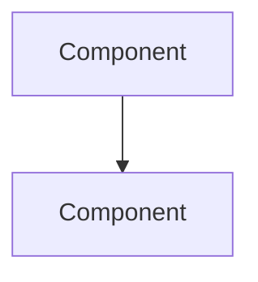

# @ralph-onboard-docs

Generate a Ralph plan to create comprehensive architecture documentation for this repository, following a proven documentation structure.

## Documentation Model

The target documentation structure consists of three layers:

1. **`docs/arch/overview.md`** — High-level architecture overview (already created by ralph-me)
2. **`docs/arch/<subsystem>.md`** — One doc per major subsystem/pattern in the codebase
3. **`docs/arch/recipes.md`** — Step-by-step checklists for common development tasks
4. **`docs/design/_catalog/`** — Catalog entries for this documentation effort

Each architecture doc follows this format:

```markdown
# Subsystem Name

## Overview

One paragraph describing the subsystem, its purpose, and how it fits into the architecture.

## Architecture



## Key Concepts

| Concept | Description |
|---------|-------------|
| Name | What it is and why it matters |

## [Pattern/Section Name]

Description of the pattern with code examples showing the canonical way to do it.

```language
// Concrete code example from the actual codebase
```

## Key Files

| File | Purpose |
|------|---------|
| `path/to/file` | What it does |
```

SCOPE.md follows this format:

```markdown
# Scope

## In Scope

- (bullet list of what this repo owns, derived from README, AGENTS.md, and code analysis)

## Out of Scope

- (bullet list of adjacent systems/repos this repo does NOT own, with pointers to where they live if known)

## Boundary Notes

- (any important notes about where this repo's responsibility ends and another begins)
```

`_COMPONENT_TEMPLATE.md` is a template for documenting individual components with sections: Overview, Ownership, Packages/Modules, Dependencies, APIs/Interfaces, Deployment, Related Docs. Each component doc created from this template goes in `docs/arch/components/<name>.md`.

## Instructions

1. Read `docs/ralph.md` to understand the plan format
2. Read `AGENTS.md` for project conventions
3. Read `docs/arch/overview.md` to understand the existing architecture overview
3b. If a "Workspace Dependencies" section is listed above with
    sibling package paths, you may read files in those directories
    to understand shared types, APIs, or patterns that this package
    imports. Do NOT create architecture docs for dependency
    packages. However, when writing recipes, include steps that
    touch dependency packages if the real workflow requires it
    (e.g., "Add translation key in ../TranslationsPackage/...",
    "Add shared type in ../CommonTypes/...").
4. **Deeply analyze the source code** to identify all major subsystems. Look for:

   **Universal patterns (any language):**
   - Build system and tooling (package manager, build tool, linter, formatter, CI)
   - Testing infrastructure (runner, utilities, patterns, fixtures)
   - Configuration management (env vars, config files, feature flags)
   - Error handling patterns (error types, propagation, recovery)
   - Logging / observability / telemetry / metrics
   - Domain model / shared types / data structures
   - Constants / enums / magic values
   - Authentication / authorization
   - Database / storage / persistence layer
   - API layer (HTTP handlers, gRPC services, GraphQL resolvers)

   **Backend patterns (Go, Java, Python, Rust, etc.):**
   - Package / module structure and dependency organization
   - Middleware chains (HTTP, gRPC interceptors)
   - Interfaces / contracts / traits and their implementations
   - Dependency injection / service wiring
   - Concurrency patterns (goroutines, channels, thread pools, async)
   - CLI commands and argument parsing
   - Database access / repository pattern / ORM usage
   - Message queues / event handling / pub-sub
   - gRPC / protobuf definitions
   - Infrastructure as code (CDK, Terraform, CloudFormation)

   **Smithy / API model patterns:**
   - Smithy model definitions (.smithy files — services, operations, shapes, errors, traits)
   - Generated clients and server stubs from Smithy models
   - Operation handlers implementing the Smithy-generated interfaces
   - Input/output shape types and validation
   - Custom traits and validators
   - Model-to-code generation pipeline (smithy-build.json, projections, plugins)

   **AWS Lambda / serverless patterns:**
   - Lambda handler functions (entry points, event types, context)
   - Lambda middleware / powertools (middy, lambda-powertools)
   - Cold start optimization (lazy initialization, provisioned concurrency)
   - Event source mappings (API Gateway, SQS, SNS, EventBridge, DynamoDB Streams)
   - Lambda layers and shared dependencies
   - Environment variable configuration per stage
   - Structured logging and tracing (X-Ray, CloudWatch Logs)
   - Error handling and retry behavior

   **CDK / Infrastructure as Code patterns:**
   - CDK app structure (app, stacks, constructs)
   - Custom constructs and L2/L3 abstractions
   - Stack organization (per-service, per-stage, shared)
   - Cross-stack references and dependencies
   - Pipeline stages and deployment waves
   - Environment/stage configuration (dev, beta, gamma, prod)
   - IAM roles and permissions (least privilege patterns)
   - Monitoring constructs (alarms, dashboards, canaries)

   **Amazon-internal patterns (Coral, Brazil, etc.):**
   - Coral model definitions (API contracts, shapes, operations, errors)
   - Activities (operation handlers implementing the Coral model)
   - Orchestrators / workflow coordination
   - Guice modules / dependency injection wiring
   - Brazil build system (build.xml, Config, brazil-build commands)
   - Apollo deployment configuration
   - Coral config / AppConfig / dynamic configuration
   - Coral metrics / CloudWatch metrics emission
   - Service client generation from Coral models
   - Middleware chain (Coral interceptors, authentication, authorization)
   - DynamoDB / AWS service integrations
   - Pipelines configuration

   **Server / BFF (backend-for-frontend) patterns:**
   - API proxy layer (request forwarding, response transformation, aggregation)
   - Authentication middleware (Janus, SigV4, session management, token handling)
   - Caching strategies (in-memory, distributed, TTL policies)
   - Rate limiting / throttling / circuit breakers
   - Health checks / operational endpoints / readiness probes
   - Feature flags / experiments / stage-based behavior (Weblab, Dials)
   - Server-side rendering (if applicable)
   - Request routing / URL mapping / controller dispatch
   - Error mapping (backend errors → client-friendly responses)
   - Multi-region / multi-stage deployment configuration

   **Frontend patterns (TypeScript, JavaScript, etc.):**
   - Routing / navigation
   - State management (stores, context, reducers)
   - Data fetching / API hooks (queries, mutations, caching)
   - UI component patterns (shared components, layouts)
   - Pages / views / screens
   - Internationalization / localization
   - Module system / microfrontend architecture

5. Create a new feature directory `docs/design/YYMMDD-docs-onboarding/` (use today's date)
6. Create `plan.md` with the structure below (Phase 1: Create Architecture Docs, Phase 2: Pattern Detection, Phase 3: Create Recipes, Phase 4: Update References, Phase 5: Catalog Registration, Phase 6: Validation)

## Plan Structure

The plan should have these phases:

### Phase 1: Create Architecture Docs

One task per subsystem doc. For each task:
- Specify which source files/directories to read
- Describe what to document: purpose, architecture diagram, key concepts, patterns with code examples, key files
- Each doc must be verified against actual code — no guessing

**Only create docs for subsystems that actually exist in this repo.** Choose from this reference list and adapt names to match the codebase:

| Doc | When to Create |
|-----|---------------|
| `build-and-tooling.md` | Always — every repo has a build system |
| `testing.md` | If the repo has tests |
| `project-structure.md` | If the package/module layout is non-trivial |
| `routing.md` | If the app has HTTP routes, gRPC services, or CLI commands |
| `middleware.md` | If there's a middleware/interceptor chain |
| `state-management.md` | If there are stores, caches, or managed state |
| `data-fetching.md` | If there's a data access or API client layer |
| `api-clients.md` | If there's a client abstraction for external services |
| `handlers.md` | If there are HTTP handlers, gRPC service impls, or CLI command handlers |
| `components.md` | If there are shared/reusable UI components |
| `pages.md` | If the app has distinct pages/views/screens |
| `domain-model.md` | If there are shared types, models, or data structures |
| `database.md` | If there's a persistence/repository layer |
| `error-handling.md` | If there's a structured error handling pattern |
| `configuration.md` | If there's config management beyond simple constants |
| `internationalization.md` | If i18n/l10n is used |
| `telemetry.md` | If there's observability, metrics, or structured logging |
| `concurrency.md` | If there are significant concurrency patterns |
| `constants.md` | If there's a constants/enums layer |
| `infrastructure.md` | If there's IaC (CDK, Terraform, CloudFormation) or deployment config (Apollo) |
| `smithy-model.md` | If there are Smithy model definitions (.smithy files, smithy-build.json) |
| `lambda-handlers.md` | If there are Lambda handler functions |
| `cdk.md` | If there's a CDK app with stacks and constructs (separate from general infra) |
| `coral-model.md` | If there are Coral model definitions (API contracts, shapes, operations) |
| `activities.md` | If there are Coral Activities implementing API operations |
| `dependency-injection.md` | If there's DI wiring (Guice modules, Spring config, etc.) |
| `api-proxy.md` | If the service proxies/aggregates calls to other services |
| `caching.md` | If there's a caching layer (in-memory, distributed, TTL policies) |
| `auth.md` | If there's authentication/authorization middleware (Janus, SigV4, sessions) |
| `feature-flags.md` | If there are feature flags, experiments, or stage-based behavior |
| `deployment.md` | If there's multi-region/multi-stage deployment config (Apollo, CDK) |
| `docs/arch/SCOPE.md` | Always — defines what this repo owns and does not own |
| `docs/arch/_COMPONENT_TEMPLATE.md` | If the repo contains 2+ distinct services, microservices, or major components |

### Phase 2: Pattern Detection

Before writing recipes, perform a structural analysis of the codebase:

- **List feature/module directories** — Enumerate all top-level feature or module directories in the codebase
- **Identify repeated directory structures** — Compare the internal directory trees of feature/module directories and identify structures that repeat 2+ times (e.g., every feature has `components/`, `hooks/`, `__tests__/`, or every module has `handler.go`, `config.go`, `_test.go`)
- **Identify central registration files** — Find files that are imported or modified by 3+ features (e.g., route registries, plugin manifests, Redux root reducers, DI modules)
- **Identify mutually exclusive approaches** — Detect cases where the codebase uses two or more different approaches to the same goal. For each pair, count how many implementations use each approach and note the distinguishing characteristics (e.g., "AbstractCredentialsProvider: 6 impls, provides stale-cred caching" vs "direct CredentialsProvider: 2 impls, ephemeral/no caching"). Output a Decision Points table in the Pattern Inventory with columns: Goal, Approach A (count), Approach B (count), When to Use A, When to Use B.
- **Scan test infrastructure** — Enumerate test directories (tst/, test/, __tests__/, *_test.go, *_test.py, etc.). Identify repeated test patterns: mock/shunt subclasses (classes extending production classes with overridden methods), fake server handlers (HTTP handlers returning canned responses), fixture directory layouts (input/expected/output subdirectories), test data factories (static builder methods returning domain objects), and test base classes (abstract test classes extended by 2+ test suites). Add these to the Pattern Inventory. For each repeated test pattern found, sample 3 test files that follow it and extract the common setup/arrange/act/assert structure. Output a Test Recipe Candidates list in the Pattern Inventory with: pattern name, occurrence count, common setup code, common assertion pattern, example files. These feed directly into test-writing recipes in recipes.md.
- **Extract failure modes** — Search for catch blocks, error logging (log.error, log.warn, logger.error, console.error), sentinel return values (null objects, error codes, fallback defaults), and custom error/exception types. Cluster by subsystem. Output a Failure Modes inventory listing: subsystem, failure mode description, how it manifests, and which files exhibit it.
- **Rank extension points by frequency** — For every base class, interface, trait, or abstract class that has 2+ concrete implementations, count the implementations. Output a ranked Boilerplate Candidates table (base type, implementation count, example implementations). The top 5 by count will receive fill-in-the-blanks templates in recipes.md. Additionally, search for repeated hook/function call patterns (e.g., useMutation, useQuery, useSelector, useEffect with the same shape) across all feature directories. Any call pattern appearing in 5+ files deserves its own atomic recipe — not just a mention in an arch doc. Output a Hook/Pattern Frequency table in the Pattern Inventory with columns: pattern name, occurrence count, example files.
- **Scan for repeated file naming conventions** — Glob for repeated file name patterns across feature directories (e.g., `*SummaryCard*`, `useGet*FlashbarItems*`, `*_unix.go`, `*_windows.go`, `*ListTable*`, `*Modal*`). Any naming pattern appearing in 3+ files across 2+ directories indicates a convention that deserves its own recipe. Output a Naming Conventions table in the Pattern Inventory with columns: glob pattern, occurrence count, example files.
- **Classify feature complexity tiers** — Group feature directories by complexity: (a) simple toggle/enable-disable features, (b) standard CRUD panels, (c) multi-step wizards, (d) standalone pages. For each tier that appears 2+ times, a composite recipe must be generated. Output a Feature Tiers table in the Pattern Inventory with columns: tier name, feature directories in this tier, distinguishing characteristics.

Output a **Pattern Inventory** section in the worklog containing one subsection for every detection category listed above. No empty sections — if a scan found nothing for a category, state "None found" with the search methodology used.

**Completeness gate:** Before proceeding to Phase 3, verify the Pattern Inventory has a subsection for every detection category in Phase 2. If any category is missing, re-scan the codebase targeting that specific category before continuing.

The recipes task in Phase 3 consumes this Pattern Inventory to derive composite recipes and registration checklists.

### Phase 3: Create Recipes

Using the Pattern Inventory from Phase 2, create `recipes.md`.

**Pattern-to-Recipe Completeness Rule:** Every item in the Phase 2 Pattern Inventory that meets its occurrence threshold MUST have a corresponding recipe in `recipes.md`. For each Pattern Inventory subsection, map every entry above threshold to a recipe type (atomic recipe, composite recipe, decision tree, test-writing recipe, failure mode entry, or boilerplate template) based on the category. Track completeness with a checklist in the worklog mapping each inventory item to its recipe number.

| Doc | When to Create |
|-----|---------------|
| `recipes.md` | Always — must contain: (1) **Atomic Recipes** — single-concern checklists derived from arch docs, (2) **Composite Recipes** — end-to-end workflows derived from the Pattern Detection phase's repeated directory structures showing every file to create/modify when adding a new feature, (3) **Registration Points Checklist** — listing every central registration file identified in pattern detection with what to add and in what order, (4) **Common Failure Modes** — one section per subsystem listing failure modes from the Phase 2 Failure Modes inventory with symptoms, root cause, and resolution steps, (5) **Decision Trees** — for each entry in the Phase 2 Decision Points table, a decision tree or comparison table showing when to use each approach, (6) **Recipe Coverage Matrix** — a table mapping each arch doc to its corresponding recipe(s), with explicit "No recipe needed — reason" for any arch doc without a recipe, (7) **Test-Writing Recipes** — for each test pattern in the Phase 2 Test Recipe Candidates list, a step-by-step recipe showing how to write that type of test with a fill-in-the-blanks boilerplate template |

**Boilerplate Templates:** For the top 5 extension points from the Phase 2 Boilerplate Candidates table, `recipes.md` must include complete fill-in-the-blanks templates with placeholder markers like `<FEATURE_NAME>`, `<MODULE_NAME>`, etc. Each template should be a copy-pasteable code block that a developer can search-and-replace to scaffold a new instance of the pattern. Include both the implementation file and any required registration/wiring changes.

### Phase 4: Update References

- Update `AGENTS.md` codebase patterns table with new docs
- Update `docs/arch/overview.md` if new subsystems were discovered
- Update `docs/design/_catalog/index.md` categories table with new Current Docs links

### Phase 5: Catalog Registration

- Add a catalog entry for this docs-onboarding design
- Update catalog category files if new categories are needed
- **Backfill catalog entries** — Populate each catalog category file with entries for every existing feature/module in the codebase. For each entry, scan git log (git log --oneline --diff-filter=A -- <path>) to find the approximate addition date and include it. Use format: "YYMMDD - feature-name" with the git-derived date. Set status to 🚀 Implemented.
- **Cross-reference catalog entries** — For each catalog entry, verify it points to an actual design document in docs/design/ (not just a source directory). If no design doc exists, add a note: "Predates design practice — no design doc available." This distinguishes a design catalog from a feature inventory.

### Phase 6: Validation

- (a) For each architecture doc, verify recipes.md has at least one recipe covering its primary use case. Output the coverage in the Recipe Coverage Matrix.
- (b) Verify that every entry in the Phase 2 Decision Points table has a corresponding decision tree in recipes.md.
- (c) Verify that the top 5 Boilerplate Candidates all have templates.
- (d) Verify that SCOPE.md exists and has at least 3 in-scope and 1 out-of-scope entries.
- (e) Run git log --diff-filter=A --name-only to identify the most frequently created file types/directories. Verify that the top 5 most common new-file patterns each have a corresponding recipe. Flag any high-frequency file type without a recipe.
- (f) For every entry in the Phase 2 Pattern Inventory — repeated directory structures, Naming Conventions entries with 3+ occurrences, Hook/Pattern Frequency entries with 5+ occurrences, Test Recipe Candidates, and Feature Tiers with 2+ members — verify that recipes.md has a corresponding recipe. Create any missing recipes before completing validation.

## Documentation Standards

Include these in the plan:

```markdown
## Documentation Standard

- **Do document**: Purpose, setup, key concepts, public API, non-obvious patterns, code examples from the actual codebase
- **Don't document**: Implementation details readable from code, every function/type, internal mechanics
- Code should be self-documenting; docs explain the "why" and "how to use", not the "what"
- Every claim must be verified against actual source code
- Include mermaid diagrams showing relationships between components
- Code examples must be real code from this repo, not hypothetical
- **Decision Trees**: When a subsystem has multiple approaches to the same goal (identified in Pattern Detection), the arch doc must include a decision tree or comparison table explaining when to use each approach — not just describe them in isolation
- **Testing in every recipe**: Each atomic recipe must end with a "#### Testing" subsection showing the corresponding test pattern — how to test the thing the recipe creates. Use the test boilerplate from the Phase 2 Test Recipe Candidates if available, otherwise derive from existing test files for similar patterns.
```

## Reference Files

Include in the plan:

```markdown
## Reference Files

- `AGENTS.md` — Project conventions and existing patterns table
- `docs/arch/overview.md` — Existing architecture overview
- `docs/design/_catalog/index.md` — Catalog structure
- `README.md` — Project overview
```

7. Tell the user the folder path and how many docs will be created
8. Suggest running `@ralph-plan-review` to validate, then Ralph to execute
