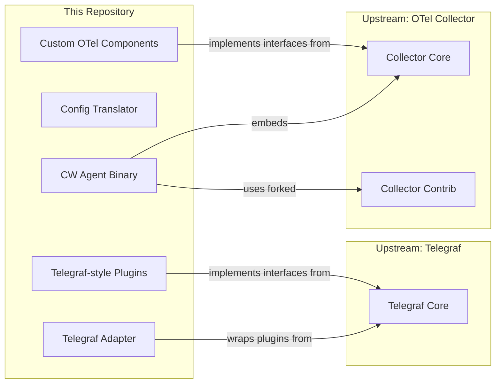

# Repository Scope

What this repository owns and does not own.

## In-Scope

| Area | Description |
|------|-------------|
| Agent binary | `cmd/amazon-cloudwatch-agent/` — Main OTel Collector-based agent process |
| Agent launcher | `cmd/start-amazon-cloudwatch-agent/` — Runs config translation then starts the agent |
| Config translation | `translator/` — Converts user JSON config into OTel Collector YAML |
| Config downloader | `cmd/config-downloader/` — Fetches config from SSM Parameter Store or S3 |
| Config wizard | `cmd/amazon-cloudwatch-agent-config-wizard/` — Interactive config generator |
| Telegraf adapter | `receiver/adapter/` — Bridges Telegraf input plugins into OTel receivers |
| OTel pipeline components | Custom receivers, processors, exporters, and extensions in `receiver/`, `processor/`, `extension/`, `plugins/` |
| System metrics collection | CPU, memory, disk, network, ethtool, NVMe via Telegraf inputs and native OTel receivers |
| Custom metrics | StatsD and collectd protocol ingestion via Telegraf input plugins |
| Container metrics | Container Insights for EKS and ECS via `awscontainerinsightreceiver` and decorator processors |
| Log tailing | `plugins/inputs/logfile/` — Tails log files and ships to CloudWatch Logs |
| Trace collection | OTel and X-Ray trace pipelines via upstream contrib receivers/exporters |
| Workload discovery | `cmd/workload-discovery/` — Detects running workloads (JVM, Tomcat, Kafka, NVIDIA GPU) |
| X-Ray migration | `cmd/xray-migration/` — Migrates X-Ray daemon config to agent config |
| Packaging | RPM, DEB, Windows ZIP, macOS tar.gz, Docker multi-arch builds in `packaging/` |
| Agent health | `extension/agenthealth/` — Self-reports health and performance data to CloudWatch |
| Entity metadata | `extension/entitystore/`, `extension/k8smetadata/` — EC2/EKS entity and K8s pod/node metadata |

## Out-of-Scope

| Area | Why |
|------|-----|
| CloudWatch service backend | AWS-managed service; agent is a client only |
| OTel Collector core framework | Upstream dependency (`go.opentelemetry.io/collector`); consumed, not owned |
| Telegraf core | Upstream dependency (forked at `github.com/aws/telegraf`); consumed via replace directive |
| AWS SDK | Upstream dependency (`github.com/aws/aws-sdk-go`, `aws-sdk-go-v2`); consumed, not owned |
| CloudWatch Logs service | AWS-managed service; agent publishes to it |
| X-Ray service backend | AWS-managed service; agent exports traces to it |
| SSM Parameter Store | AWS-managed service; config-downloader reads from it |
| Container Insights backend processing | Server-side metric aggregation and dashboards |
| EKS/ECS control plane | Kubernetes and ECS orchestration; agent runs as a workload within them |

## Upstream Boundaries

The agent embeds the OTel Collector as a library and registers custom component factories alongside forked upstream contrib components. Telegraf plugins are wrapped by the adapter receiver to participate in OTel pipelines. Both upstream dependencies use `replace` directives in `go.mod` pointing to AWS-maintained forks (`github.com/aws/telegraf`, `github.com/amazon-contributing/opentelemetry-collector-contrib`).
