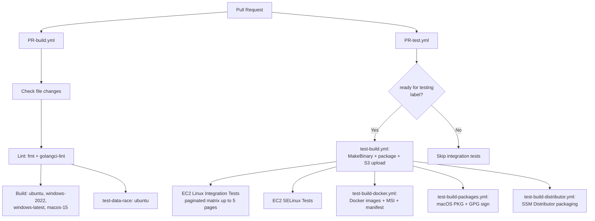

# Build System and Developer Tooling

This document covers the build system, cross-compilation, linting, CI workflows, and developer tooling for the CloudWatch Agent.

## Make Targets

| Target | Description |
|---|---|
| `make build` | Cross-compile all binaries for linux, darwin, and windows |
| `make release` | Clean, test, build, then package RPM/DEB/ZIP/tar |
| `make test` | Unit tests with coverage (`CGO_ENABLED=0`, 15m timeout) |
| `make test-data-race` | Race-detector tests (`CGO_ENABLED=1`, excludes known-racy packages) |
| `make lint` | golangci-lint v2 + license check + import order check |
| `make fmt` | `go fmt` + `goimports` with local prefix |
| `make fmt-sh` | Shell script formatting via `shfmt` |
| `make clean` | Remove `build/`, `release/`, and `CWAGENT_VERSION` |
| `make docker-build` | Multi-arch Docker image (linux/amd64 + linux/arm64) |
| `make docker-build-amd64` | Single-arch Docker image (linux/amd64) |
| `make docker-build-arm64` | Single-arch Docker image (linux/arm64) |
| `make build-for-docker` | Fast amd64-only build (no wizard or config-downloader) |

The `release` target chains: `clean` → `test` → `build` → `package-rpm` → `package-deb` → `package-win` → `package-darwin`.

## Cross-Compilation

| Platform | Architectures | CGO_ENABLED | Notes |
|---|---|---|---|
| Linux | amd64, arm64 | 0 | Static binaries |
| Darwin | amd64, arm64 | 1 | Requires macOS host; skipped on non-Darwin |
| Windows | amd64 | not set | Single architecture only |

All builds use `-trimpath` and `-buildmode=${CWAGENT_BUILD_MODE}` (defaults to `default`, can be set to `pie`).

## Version Injection

Version and build time are injected via LDFLAGS at compile time:

```makefile
LDFLAGS = -s -w
LDFLAGS += -X github.com/aws/amazon-cloudwatch-agent/cfg/agentinfo.VersionStr=${VERSION}
LDFLAGS += -X github.com/aws/amazon-cloudwatch-agent/cfg/agentinfo.BuildStr=${BUILD}
```

- `-s -w` strips debug info and symbol tables
- `VERSION` comes from `git describe --tag --dirty`, falling back to the `CWAGENT_VERSION` file
- `BUILD` is a UTC timestamp (`YYYY-MM-DDTHH:MM:SSZ`)

## Linting (golangci-lint v2)

Configuration lives in `.golangci.yml`.

Enabled linters:
- `gosec` — Security issue detection
- `misspell` — Spelling errors in comments/strings
- `nonamedreturns` — Disallows named return values
- `revive` — Extensible Go linter (superset of golint)

Disabled linters:
- `errcheck` — Explicitly disabled

Formatters (run as part of lint):
- `gofmt` with simplify
- `goimports` with local prefix `github.com/aws/amazon-cloudwatch-agent`

Key settings:
- `issues.new-from-rev: 9af4477` — Only reports issues introduced after this commit
- Excludes `third_party`, `builtin`, `examples` paths
- Suppresses `revive` var-naming in `translator/translate/util/`

## Import Ordering

The `impi` tool enforces the `stdThirdPartyLocal` import grouping scheme:

1. Standard library
2. Third-party packages
3. Local packages (`github.com/aws/amazon-cloudwatch-agent`)

`plugins/plugins.go` is excluded from import order checks because it bulk-imports all plugin packages.

## License Headers

The `addlicense` tool enforces MIT license headers on all `.go` files:

```
// Copyright Amazon.com, Inc. or its affiliates. All Rights Reserved.
// SPDX-License-Identifier: MIT
```

Uses SPDX-only format with no year field. The `checklicense` target verifies headers; `addlicense` target adds missing ones.

## Secret Scanning

The `check_secrets` target runs before every build. It greps the source tree for AWS access key patterns (`AKIA...`, `SECRET_ACCESS_KEY`, etc.), excluding `build/`, `vendor/`, and the MSI WXS file. The build fails if any match is found.

## Data Race Exclusion List

The `test-data-race` target runs all tests with `-race` except packages with known data races:

| Package | Reason |
|---|---|
| `extension/entitystore` | Known race |
| `extension/server` | Known race |
| `internal/publisher` | Known race |
| `internal/retryer` | Known race |
| `internal/tls` | Known race |
| `plugins/inputs/logfile` | Known race |
| `plugins/inputs/logfile/tail` | Known race |
| `plugins/outputs/cloudwatch` | Known race |
| `plugins/processors/ec2tagger` | Known race |

These are tracked as TODOs to fix.

## CI Workflow Structure



### PR-build.yml

Triggered on PRs to `main*` and `feature*` branches. Uses `dorny/paths-filter` with `.github/config/file-filters.yml` to skip builds when only non-code files change.

Jobs:
1. `changes` — Detect which file categories changed
2. `lint` — Format check (`make fmt fmt-sh`) + lint (`make lint`)
3. `build` — Matrix build on ubuntu-latest, windows-2022, windows-latest, macos-15 (runs `make test` then `make amazon-cloudwatch-agent-{family}`)
4. `test-data-race` — Race detector tests on ubuntu-latest

### PR-test.yml

Requires the `ready for testing` label on the PR. Orchestrates:
1. Build and upload binaries to S3 (via `test-build.yml`)
2. Start LocalStack for local AWS service emulation
3. Generate test matrix from the test repo's generator
4. Run EC2 Linux integration tests (paginated into up to 5 pages of 200 tests each)
5. Run EC2 SELinux integration tests
6. Tear down LocalStack

### test-build.yml (Build And Upload)

Reusable workflow called by PR-test and release pipelines:
- Builds linux + windows binaries
- Creates RPM, DEB, and Windows ZIP packages
- GPG-signs all build artifacts
- Uploads to S3 at the specified bucket key

### test-build-docker.yml (Docker Images)

- Builds multi-arch Linux container images (amd64 + arm64) from RPMs
- Builds Windows container image from MSI (on windows-2022 runner)
- Creates and pushes a multi-platform Docker manifest to ECR

### test-build-packages.yml (macOS Packages)

- Builds macOS `.pkg` installers on a macos-15 runner (amd64 + arm64)
- GPG-signs the packages on a separate ubuntu runner

### test-build-distributor.yml (SSM Distributor)

- Packages binaries for SSM Distributor (linux, darwin, windows)
- Creates/updates an SSM document with version management
- Enforces a version limit (default 25) by removing oldest versions

## Build Output Structure

```
build/
├── bin/
│   ├── CWAGENT_VERSION
│   ├── linux_amd64/
│   │   ├── amazon-cloudwatch-agent
│   │   ├── config-downloader
│   │   ├── config-translator
│   │   ├── start-amazon-cloudwatch-agent
│   │   ├── amazon-cloudwatch-agent-config-wizard
│   │   └── workload-discovery
│   ├── linux_arm64/          # Same binaries as amd64
│   ├── darwin_amd64/         # Same binaries (macOS only)
│   ├── darwin_arm64/         # Same binaries (macOS only)
│   └── windows_amd64/       # .exe versions + workload-discovery.exe
├── private/                  # Packaging staging area
│   ├── linux/{amd64,arm64}/{rpm,deb}/
│   ├── windows/amd64/zip/
│   └── darwin/{amd64,arm64}/tar/
└── tools/                    # Installed dev tools (goimports, golangci-lint, etc.)
```

## Docker Image

The Docker image is tagged as `amazon/cloudwatch-agent:${VERSION}`. Two Dockerfile paths exist:

| Dockerfile | Use Case |
|---|---|
| `localbin/Dockerfile` | Build from local binaries (used by `make docker-build`) |
| `source/Dockerfile` | Build from source inside Docker |
| `localal2/Dockerfile` | Build from local RPMs (used by CI) |
| `Dockerfile.Windows` | Windows container image |

The `build-for-docker` targets copy `opentelemetry-jmx-metrics.jar` into the build output for JMX metrics support.

## File Change Filters

`.github/config/file-filters.yml` controls which CI jobs run:

- `lint` — Triggered by `*.go`, `*.sh`, `.golangci.yml`, `packaging/**`, `go.mod`, `Makefile`
- `build` — Triggered by `Makefile`, `go.sum`, `*.go`, `*.toml`, `*.json`, `*.conf` (excludes non-build YAML in `.github/` and container insights)
