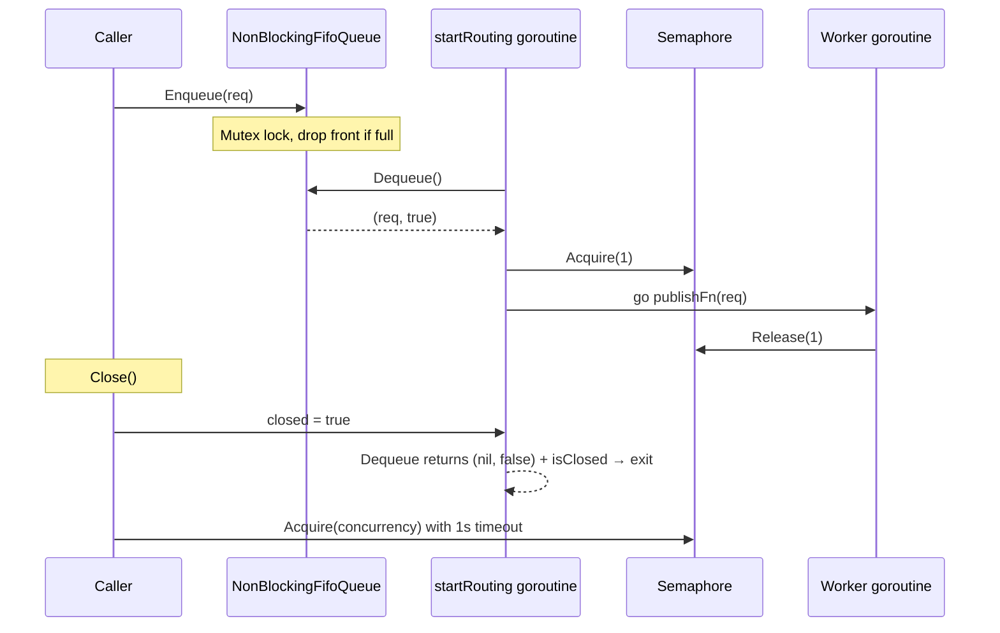

# Concurrency Patterns

The CloudWatch Agent uses several concurrency patterns across its subsystems. This document covers the primary patterns, their usage, and known data race issues.

## Overview

```mermaid
graph TD
    subgraph "Publisher Pattern"
        PQ[NonBlockingFifoQueue] -->|Dequeue| PR[Publisher Router Goroutine]
        PR -->|Semaphore-limited| PW1[Worker Goroutine 1]
        PR -->|Semaphore-limited| PW2[Worker Goroutine N]
    end

    subgraph "Channel Pipeline (CloudWatch Output)"
        AGG[Aggregator Goroutines] -->|aggregationChan| DA[durationAggregator]
        DA -->|metricChan| PDM[pushMetricDatum Goroutine]
        PDM -->|datumBatchChan| PUB[publish Goroutine]
        PUB --> PUBLISHER[Publisher]
    end

    subgraph "Background Refresh"
        DONE[done chan] -.->|shutdown signal| EC2[ec2Info.initEc2Info]
        DONE -.->|shutdown signal| SP[serviceprovider refreshLoops]
        DONE -.->|shutdown signal| TAG[ec2tagger refreshLoops]
    end

    subgraph "File Watching"
        FSN[fsnotify Watcher] -->|Events chan| CW[CertWatcher.Watch]
        CW -->|RWMutex| TLS[currentTLSConfig]
    end
```



## Non-Blocking Publisher

`internal/publisher/publisher.go` implements a concurrent pub/sub system with bounded parallelism.

Key components:
- `NonBlockingFifoQueue` — mutex-protected FIFO backed by `container/list`. Drops the oldest entry when full (back-pressure via eviction, not blocking).
- `Publisher` — routes items from the queue to worker goroutines. Uses `golang.org/x/sync/semaphore` to cap concurrency.
- Graceful shutdown — `Close()` sets a `closed` flag (protected by `sync.RWMutex`), waits for the queue to drain with a configurable timeout, then acquires the full semaphore to wait for in-flight workers.



Usage: The CloudWatch output creates a Publisher in `Start()` with `NewNonBlockingFifoQueue(metricChanBufferSize)` and `MaxConcurrentPublishers` workers. Each worker calls `WriteToCloudWatch` to make the PutMetricData API call.

## CloudWatch Output Pipeline

The CloudWatch exporter (`plugins/outputs/cloudwatch/`) uses a multi-stage channel pipeline with dedicated goroutines at each stage:

1. `ConsumeMetrics()` → `Aggregator.AddMetric()` — caller goroutine pushes metrics into the aggregator
2. `durationAggregator.aggregating()` — one goroutine per aggregation interval, reads from `aggregationChan`, accumulates into `metricMap`, flushes on ticker to `metricChan`
3. `pushMetricDatum()` — single goroutine reads from `metricChan`, builds `MetricDatumBatch`, sends full batches to `datumBatchChan`
4. `publish()` — single goroutine reads from `datumBatchChan`, publishes via `Publisher`

Shutdown flows through `shutdownChan` (closed in `Shutdown()`), which each goroutine selects on. The aggregator has a separate `aggregatorShutdownChan` and `sync.WaitGroup` to ensure final flush completes.

The aggregator is single-writer per duration (each `durationAggregator` owns its `metricMap`), so no mutex is needed on the map itself — concurrency is serialized through the `aggregationChan` channel.

## Background Refresh with Done Channel

Several subsystems use a `done chan struct{}` pattern for cancellable background goroutines:

### Entity Store (`extension/entitystore/`)

On `Start()`, launches goroutines for:
- `ec2Info.initEc2Info()` — retries IMDS metadata fetch in a loop, `select` on `done` between retries
- `serviceprovider.startServiceProvider()` — launches two `Retryer.refreshLoop` goroutines (IAM role + IMDS service name/ASG)
- `StartPodToServiceEnvironmentMappingTtlCache()` — starts the `ttlcache` eviction loop

`Shutdown()` closes `done`, which unblocks all waiting goroutines.

Shared state protection:
- `EC2Info` — `sync.RWMutex` protects `InstanceID` and `AccountID` (written once by `initEc2Info`, read by many)
- `serviceprovider` — `sync.RWMutex` protects `iamRole`, `imdsServiceName`, `autoScalingGroup`; separate `logMutex` for `logFiles`/`logGroups` maps
- `autoscalinggroup.once` — `sync.Once` ensures ASG is set only once

### EC2 Tagger (`plugins/processors/ec2tagger/`)

On `Start()`, launches:
- Initial tag/volume retrieval goroutine
- `refreshLoopToUpdateTags()` — spawns a goroutine with host-based jitter delay before periodic tag refresh
- `refreshLoopToUpdateVolumes()` — same pattern for EBS volume mappings

`ec2TagCache` is protected by an embedded `sync.RWMutex` on the `Tagger` struct. The volume `Cache` has its own internal `sync.RWMutex`.

Shutdown via `shutdownC chan bool` and `context.CancelFunc`.

## TLS Certificate Watching

`internal/tls/certWatcher.go` uses `fsnotify` to watch certificate files for changes:

- `Start()` adds file watches with retry (polling every 1s for up to 10s), then launches `Watch()` in a goroutine
- `Watch()` selects on `watcher.Events` and `watcher.Errors` channels
- On file change, `ReadTlsConfig()` reloads the TLS config under `sync.RWMutex` and invokes a registered callback in a new goroutine
- `GetTLSConfig()` reads under `RLock`
- `Start()` blocks on `ctx.Done()`, then closes the watcher

## Log File Tailing

`plugins/inputs/logfile/` manages per-file goroutines:

- `LogFile.Start()` launches a cleanup goroutine (hourly state folder cleanup, stopped via `done` channel)
- `FindLogSrc()` creates a `tailerSrc` per matched file. Each `tailerSrc` constructor launches `stateManager.Run()` in a goroutine
- `tailerSrc.SetOutput()` uses `sync.Once` to launch `runTail()` (and optionally `runSender()` for backpressure mode)
- `runTail()` reads from `tailer.Lines` channel, assembles multiline events, publishes via `outputFn`
- Backpressure mode: `runSender()` goroutine reads from a buffered `buffer` channel; `publishEvent()` writes to the buffer with a fallback that closes the file descriptor after a timeout if the buffer is full
- `tailerSrc.Stop()` uses `sync.Once` to close `done` and `buffer` channels safely
- Cleanup propagates via `removeTailerSrcCh` channel back to the parent `LogFile`

## Map With Expiry

`internal/mapWithExpiry/mapWIthExpiry.go` provides a TTL map. It is **not** internally synchronized — callers must provide their own locking. The `CleanUp(now)` method iterates and deletes expired entries. Used by subsystems that already hold a mutex during access.

## Safe Channel Close

`internal/k8sCommon/k8sclient/kubernetes_utils.go` provides `SafeChannel` — a mutex-protected wrapper around `chan struct{}` that prevents double-close panics:

```go
type SafeChannel struct {
    sync.Mutex
    Ch     chan struct{}
    Closed bool
}
```

`Close()` acquires the lock, checks `Closed`, and only closes `Ch` if not already closed. Used by the k8smetadata extension for Kubernetes informer stop channels.

## Known Data Race Packages

The following packages are excluded from `make test-data-race` (run with `-race` flag):

| Package | Notes |
|---|---|
| `extension/entitystore` | Concurrent IMDS metadata refresh and entity reads |
| `extension/server` | Concurrent access to entity store from HTTP handlers |
| `internal/publisher` | Race between Publish/Close and routing goroutine |
| `internal/retryer` | Concurrent retry state access |
| `internal/tls` | Race between certificate reload and TLS config reads |
| `plugins/inputs/logfile` | Tailer goroutine lifecycle races |
| `plugins/inputs/logfile/tail` | Underlying tail library races |
| `plugins/outputs/cloudwatch` | Multi-stage channel pipeline races |
| `plugins/processors/ec2tagger` | Tag cache refresh vs read races |

These packages are tested without the race detector via `make test`. The exclusion list is in the `Makefile` as `PKG_WITH_DATA_RACE`.

## Concurrency Primitives Summary

| Primitive | Where Used | Purpose |
|---|---|---|
| `sync.RWMutex` | ec2Info, serviceprovider, ec2tagger, volume.Cache, CertWatcher | Protect shared state with many readers, few writers |
| `sync.Once` | tailerSrc.startTailerOnce/stopOnce, autoscalinggroup.once | One-time initialization or shutdown |
| `sync.WaitGroup` | CloudWatch aggregator, Publisher | Wait for goroutine completion during shutdown |
| `atomic.Bool` | EntityStore.ready, k8smetadata.ready | Lock-free readiness flag |
| `semaphore.Weighted` | Publisher | Bound concurrent worker goroutines |
| `chan struct{}` (done) | EntityStore, ec2Info, serviceprovider, Retryer, tailerSrc, LogFile | Broadcast shutdown signal |
| Buffered channels | metricChan, datumBatchChan, aggregationChan, removeTailerSrcCh | Decouple producer/consumer stages |
| `SafeChannel` | k8smetadata extension | Prevent double-close panics on stop channels |

## Related Docs

- [Plugins & Pipeline](plugins-pipeline.md) — OTel component lifecycle
- [Error Handling](error-handling.md) — Retry patterns that spawn goroutines
- [Testing](testing.md) — Data race exclusion list and race detector usage
- [Build & Tooling](build-and-tooling.md) — `make test-data-race` target
