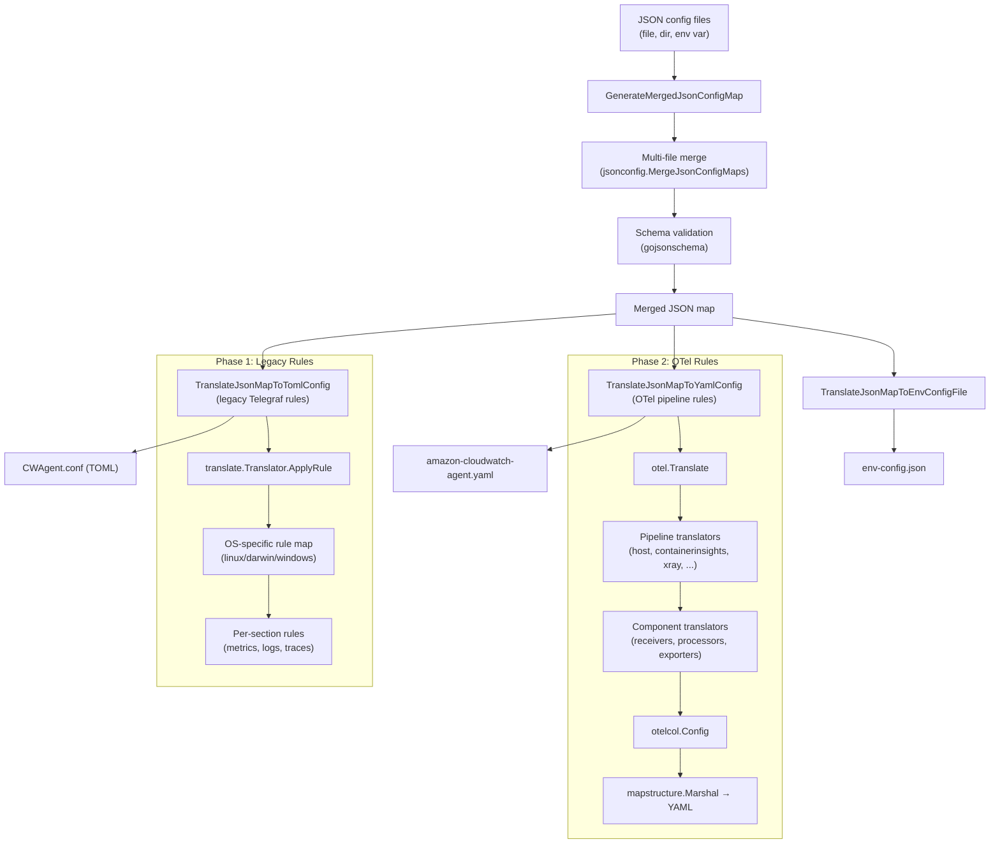

# Config Translation

The config translation engine converts user-facing JSON configuration into the internal formats the agent needs at runtime: a TOML config for legacy Telegraf plugin settings and a YAML config for the OTel Collector pipeline.

## Translation Flow



## Orchestration

The translation is orchestrated by `tool/translator/translator.go` (`ConfigTranslator.Translate`), invoked as the `config-translator` subcommand of the agent binary:

1. Parse common config (TOML), set credentials/proxy/SSL/IMDS on `context.Context`
2. Detect agent mode (`ec2`, `onPrem`, `withIRSA`) and Kubernetes mode (`EKS`, `K8sEC2`, `K8sOnPrem`)
3. Call `cmdutil.GenerateMergedJsonConfigMap` — loads, merges, and validates JSON configs
4. Call `cmdutil.TranslateJsonMapToTomlConfig` — Phase 1 legacy translation
5. Call `cmdutil.TranslateJsonMapToYamlConfig` — Phase 2 OTel translation
6. Write TOML, YAML, and env-config files to disk

Source: `tool/translator/translator.go`, `translator/cmdutil/translatorutil.go`

## Phase 1: Legacy Telegraf Rules

The legacy translation converts JSON config sections into a Telegraf-compatible config structure (serialized as TOML).

### The Rule Interface

```go
// translator/rule.go
type Rule interface {
    ApplyRule(interface{}) (string, interface{})
}
```

Every rule receives the relevant JSON subtree and returns a `(key, value)` pair. An empty key means the rule produced no output.

### Rule Registration

Rules self-register via `init()` functions using OS-specific registration:

```go
// translator/translate/metrics/metrics_collect/cpu/cpu.go
func init() {
    c := new(Cpu)
    parent.RegisterLinuxRule(SectionKey_CPU, c)
    parent.RegisterDarwinRule(SectionKey_CPU, c)
}
```

All rules are imported as a group via `translator/registerrules/register_rules.go`, which uses blank imports to trigger `init()` across the entire rule tree.

### Rule Processing Helpers

| Helper | Purpose |
|--------|---------|
| `ProcessRuleToApply` | Apply child rules that have explicit translation logic |
| `ProcessNoRuleToApply` | 1:1 passthrough for fields without rules |
| `ProcessDefaultConfig` | Apply all child rules with empty input (defaults) |
| `ProcessRuleToMergeAndApply` | Apply rules and merge map results into existing keys |

### Top-Level Translation

`translate.Translator.ApplyRule` selects the OS-specific rule map, applies the `agent` rule first (for global settings), then iterates sorted section rules. Each section rule returns inputs, outputs, processors, and aggregators which are merged into the final config map.

Source: `translator/translate/translate.go`

## Phase 2: OTel Pipeline Rules

The OTel translation converts JSON config into an `otelcol.Config` struct — the native OTel Collector configuration.

### Translator Interface

```go
// translator/translate/otel/common/common.go
type Translator[C any, ID TranslatorID] interface {
    Translate(*confmap.Conf) (C, error)
    ID() ID
}
```

Two specializations:
- `ComponentTranslator` — translates JSON into a `component.Config` (receiver, processor, exporter, extension)
- `PipelineTranslator` — translates JSON into a `*ComponentTranslators` (a set of component translators forming a pipeline)

### TranslatorMap

`TranslatorMap` is an ordered map of translators keyed by ID. It supports `Set`, `Get`, `Merge`, `Range`, and `Keys`. Pipeline translators and component translators both use this container.

### Pipeline Registration

Pipeline translators are registered in `otel.Translate()` (`translator/translate/otel/translate_otel.go`):

```go
translators.Merge(host.NewTranslators(conf, host.MetricsKey, os))
translators.Merge(host.NewTranslators(conf, host.LogsKey, os))
translators.Merge(containerinsights.NewTranslators(conf))
translators.Set(applicationsignals.NewTranslator(pipeline.SignalTraces))
translators.Set(emf_logs.NewTranslator())
translators.Set(xray.NewTranslator())
translators.Set(systemmetrics.NewTranslator())
// ... etc
```

Each pipeline translator checks whether its JSON config section exists and, if so, returns a `ComponentTranslators` struct containing the receivers, processors, exporters, and extensions for that pipeline.

### Build Phase

After all pipelines are translated, `build()` iterates the service pipelines and calls each component translator's `Translate(conf)` to produce the final `component.Config` values:

```
for each pipeline:
    for each receiver ID  → find translator → Translate(conf) → cfg.Receivers[id]
    for each processor ID → find translator → Translate(conf) → cfg.Processors[id]
    for each exporter ID  → find translator → Translate(conf) → cfg.Exporters[id]
for each extension ID     → find translator → Translate(conf) → cfg.Extensions[id]
```

The resulting `otelcol.Config` is validated via `xconfmap.Validate`, then marshaled to a `map[string]any` via `mapstructure.Marshal` and serialized to YAML.

### Pipeline Types

| Pipeline | Signal | JSON Config Path | Source |
|----------|--------|------------------|--------|
| host | metrics | `metrics::metrics_collected::*` | `pipeline/host/` |
| hostDeltaMetrics | metrics | (delta metric plugins) | `pipeline/host/` |
| hostCustomMetrics | metrics | (customized metrics) | `pipeline/host/` |
| containerinsights | metrics | `logs::metrics_collected::kubernetes` | `pipeline/containerinsights/` |
| emf_logs | logs | `logs::logs_collected::files` | `pipeline/emf_logs/` |
| xray | traces | `traces::traces_collected::xray` | `pipeline/xray/` |
| application_signals | traces/metrics | `traces::traces_collected::application_signals` | `pipeline/applicationsignals/` |
| prometheus | metrics | `logs::metrics_collected::prometheus` | `pipeline/prometheus/` |
| jmx | metrics | `metrics::metrics_collected::jmx` | `pipeline/jmx/` |
| containerinsightsjmx | metrics | (Container Insights + JMX) | `pipeline/containerinsightsjmx/` |
| systemmetrics | metrics | `agent::system_metrics_enabled` | `pipeline/systemmetrics/` |

## Multi-File Config Merge

Multiple JSON config files are merged before translation. The merge mode is set via the `--multi-config` flag:

| Mode | Behavior |
|------|----------|
| `default` | Load only `.tmp` files from the config directory |
| `append` | Load existing files + `.tmp` files, merge together |
| `remove` | Load only existing files (`.tmp` files removed) |

### Merge Rules

1. Global config keys (e.g., `agent`): no conflicts allowed — either one source defines the value, or all sources define the same value
2. Plugin config keys: identical entries merge into one instance; different entries become separate instances in a list
3. Special keys (`jmx`, `otlp`): support both array and object forms, with automatic conversion during merge

Source: `translator/jsonconfig/mergeJsonConfig.go`, `translator/jsonconfig/mergeJsonUtil/util.go`

### Container Fallback

When no JSON config files are found and `RUN_IN_CONTAINER=True`, the agent reads JSON from the `CW_CONFIG_CONTENT` environment variable. On ECS with `USE_DEFAULT_CONFIG=True`, a built-in default ECS config is used.

## Translation Context

`translator/context/context.go` provides a singleton `Context` that carries state through the translation:

| Field | Purpose |
|-------|---------|
| `os` | Target platform (linux, darwin, windows) |
| `mode` | Agent mode (ec2, onPrem, withIRSA) |
| `kubernetesMode` | K8s mode (EKS, K8sEC2, K8sOnPrem) |
| `credentials` | AWS credentials from common config |
| `proxy` | Proxy settings from common config |
| `ssl` | SSL settings from common config |
| `runInContainer` | Whether running in a container |
| `multiConfig` | Multi-config merge mode |

## Output Files

| File | Format | Consumer |
|------|--------|----------|
| `CWAgent.conf` | TOML | Telegraf plugin configuration (via adapter receiver) |
| `amazon-cloudwatch-agent.yaml` | YAML | OTel Collector service configuration |
| `env-config.json` | JSON | Environment variable overrides extracted from JSON config |

## Golden File Test Pattern

Translation correctness is verified using golden file tests in `translator/tocwconfig/tocwconfig_test.go`. Each test case has three files in `translator/tocwconfig/sampleConfig/`:

| File | Purpose |
|------|---------|
| `<name>.json` | Input JSON config |
| `<name>.conf` | Expected TOML output |
| `<name>.yaml` | Expected YAML output |

The test flow:
1. Load JSON input
2. Translate to TOML → parse both expected and actual as `TomlConfig` struct → compare
3. Translate to YAML → parse both expected and actual as generic YAML → deep-compare

```go
// translator/tocwconfig/tocwconfig_test.go
func checkTranslation(t *testing.T, fileName string, targetPlatform string, ...) {
    jsonFilePath := fmt.Sprintf("./sampleConfig/%v.json", fileName)
    tomlFilePath := fmt.Sprintf("./sampleConfig/%v.conf", fileName)
    yamlFilePath := fmt.Sprintf("./sampleConfig/%v.yaml", fileName)
    // ... translate and compare
}
```

## Decision Tree: Legacy Rule vs OTel Translation Rule

```
Is this a new JSON config field?
├── Yes: Does it configure a Telegraf plugin?
│   ├── Yes → Add a legacy rule in translator/translate/metrics/ or logs/
│   │         AND an OTel adapter translator in translator/translate/otel/receiver/adapter/
│   └── No → Is it a native OTel component?
│       ├── Yes → Add an OTel translation rule in translator/translate/otel/
│       └── No → Add to both systems as needed
└── No: Modifying existing behavior?
    └── Find the existing rule/translator and update it
```

## Related Docs

- [Configuration](configuration.md) — JSON schema, common config, env vars
- [Plugins & Pipeline](plugins-pipeline.md) — OTel pipeline and plugin system
- [Project Structure](project-structure.md) — Package layout
- [Testing](testing.md) — Golden file test details
