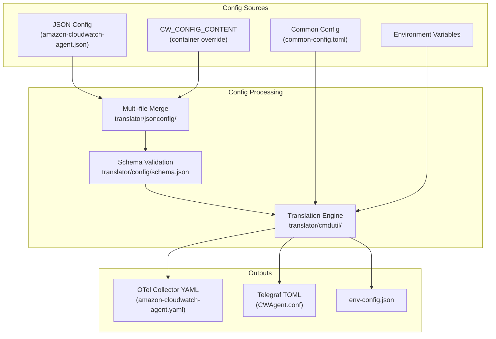

# Configuration

The CloudWatch Agent uses a layered configuration system: a user-facing JSON config, a TOML common config for credentials/proxy/SSL, and environment variables for runtime overrides. At startup, the config-translator binary merges, validates, and translates these into the OTel collector YAML that drives the pipeline.

## Configuration Layers



## JSON Config Schema

The primary user-facing config is a JSON file with four top-level sections. The schema is defined in `translator/config/schema.json` (JSON Schema draft-04) and embedded via `//go:embed` in `translator/config/schema.go`.

| Section | Purpose | Key Sub-fields |
|---------|---------|----------------|
| `agent` | Global agent settings | `metrics_collection_interval`, `region`, `credentials`, `debug`, `logfile`, `omit_hostname`, `service.name`, `deployment.environment` |
| `metrics` | System and custom metric collection | `namespace`, `metrics_collected` (cpu, mem, disk, net, statsd, collectd, prometheus, nvidia_smi, jmx, otlp), `append_dimensions`, `aggregation_dimensions`, `force_flush_interval`, `metrics_destinations` |
| `logs` | Log collection and CloudWatch Logs shipping | `logs_collected` (files, windows_events), `metrics_collected` (app_signals, ecs, kubernetes, prometheus), `log_stream_name`, `force_flush_interval` |
| `traces` | Trace collection (X-Ray, OTLP, Application Signals) | `traces_collected` (xray, otlp, app_signals), `concurrency`, `buffer_size_mb`, `endpoint_override` |

Each section supports its own `credentials` and `endpoint_override` for per-pipeline AWS configuration.

Minimal example:

```json
{
  "metrics": {
    "metrics_collected": {
      "mem": {
        "measurement": ["mem_used_percent"]
      }
    }
  }
}
```

## Common Config (TOML)

The file `cfg/commonconfig/common-config.toml` is parsed before JSON translation. It configures cross-cutting concerns that apply to both SSM config downloads and CloudWatch API calls.

Sections (all optional):

```toml
[credentials]
  shared_credential_profile = "AmazonCloudWatchAgent"
  shared_credential_file = "/path/to/credentials"

[proxy]
  http_proxy = "http://proxy:3128"
  https_proxy = "https://proxy:3128"
  no_proxy = "169.254.169.254"

[ssl]
  ca_bundle_path = "/path/to/ca-bundle.crt"

[imds]
  imds_retries = 1
```

Parsed by `cfg/commonconfig/commonconfig.go` into the `CommonConfig` struct using `github.com/BurntSushi/toml`.

## Environment Variables

Defined in `cfg/envconfig/envconfig.go`. These override or supplement file-based config at runtime.

| Variable | Purpose |
|----------|---------|
| `RUN_IN_CONTAINER` | Set to `True` when running in a container |
| `RUN_IN_AWS` | Set to `True` when running on AWS infrastructure |
| `RUN_WITH_IRSA` | Set to `True` for IAM Roles for Service Accounts |
| `USE_DEFAULT_CONFIG` | Set to `True` to use built-in default config (ECS/EKS) |
| `CW_CONFIG_CONTENT` | Inline JSON config (container alternative to config file) |
| `CW_OTEL_CONFIG_CONTENT` | Inline OTel YAML config |
| `HOST_NAME` | Override hostname |
| `POD_NAME` | Kubernetes pod name |
| `HOST_IP` | Host IP address |
| `CWAGENT_LOG_LEVEL` | Agent log level (set to `DEBUG` via `agent.debug: true`) |
| `CWAGENT_USAGE_DATA` | `false` to disable usage data reporting |
| `CWAGENT_USER_AGENT` | Custom user-agent string |
| `AWS_SDK_LOG_LEVEL` | AWS SDK debug logging level |
| `IMDS_NUMBER_RETRY` | IMDS retry count override |
| `HTTP_PROXY` / `HTTPS_PROXY` / `NO_PROXY` | Proxy settings |
| `AWS_CA_BUNDLE` | CA bundle path |
| `AMZ_SOURCE_ACCOUNT` / `AMZ_SOURCE_ARN` | Confused deputy prevention headers |

The `toenvconfig` package (`translator/tocwconfig/toenvconfig/`) extracts select JSON config values into `env-config.json`, which the agent reads at startup to set environment variables like `CWAGENT_LOG_LEVEL` and proxy settings.

## AWS Credential Chain

Defined in `cfg/aws/credentials.go`. The agent resolves credentials through a pluggable chain:

1. **Static credentials** — `AccessKey`/`SecretKey` from JSON config `credentials` section
2. **Refreshable shared credentials** — `Profile`/`Filename` from common-config.toml `[credentials]` section (auto-refreshes with 10-minute expiry window)
3. **Default SDK chain** — EC2 instance role, ECS task role, environment variables (fallback when neither static nor shared credentials are configured)

When `role_arn` is specified, the agent performs STS AssumeRole using the root credentials above. The STS client tries the regional endpoint first, falling back to the partitional endpoint if the regional endpoint returns `RegionDisabledException`.

The `CredentialConfig` struct holds per-section credential configuration:

```go
// From cfg/aws/credentials.go
type CredentialConfig struct {
    Region    string
    AccessKey string
    SecretKey string
    RoleARN   string
    Profile   string
    Filename  string
    Token     string
}
```

## Config Modes

Defined in `translator/config/mode.go`. The mode determines default config values and runtime behavior.

| Mode | Constant | When Used |
|------|----------|-----------|
| `ec2` | `ModeEC2` | Running on EC2 (default) |
| `onPrem` | `ModeOnPrem` | On-premises servers |
| `onPremise` | `ModeOnPremise` | Alias for `onPrem` |
| `withIRSA` | `ModeWithIRSA` | EKS with IAM Roles for Service Accounts |

Kubernetes-specific modes (set via `SetKubernetesMode`):

| Mode | Constant | When Used |
|------|----------|-----------|
| `EKS` | `ModeEKS` | Amazon EKS |
| `K8sEC2` | `ModeK8sEC2` | Self-managed Kubernetes on EC2 |
| `K8sOnPrem` | `ModeK8sOnPrem` | Self-managed Kubernetes on-premises |

## OS-Specific Defaults

Defined in `translator/config/defaultConfig.go`. The `DefaultJsonConfig(os, mode)` function returns a built-in JSON config based on OS and mode. Key differences:

| OS | On-Prem Default | EC2 Default |
|----|-----------------|-------------|
| Linux | `mem_used_percent`, `disk.used_percent`, `run_as_user: cwagent` | Same + `append_dimensions` (ImageId, InstanceId, InstanceType, AutoScalingGroupName) |
| Darwin | Same as Linux | Same as Linux EC2 |
| Windows | `Memory.% Committed Bytes In Use`, `LogicalDisk.% Free Space` (no `run_as_user`) | Same + `append_dimensions` |

ECS has a separate default (`DefaultECSJsonConfig`) that enables `logs.metrics_collected.ecs`.

## Multi-File Config Merge

The agent supports merging multiple JSON config files from a config directory. Controlled by the `multiConfig` context flag:

| Mode | Behavior |
|------|----------|
| `default` | Read only `.tmp` files from config directory |
| `append` | Read existing files + `.tmp` files, merge all |
| `remove` | Read existing files only (`.tmp` files removed) |

Merge rules (`translator/jsonconfig/mergeJsonConfig.go`):
- Global config (e.g., `agent` section): no conflicts allowed — either one source defines a value, or all sources agree
- Plugin config: identical configs merge into one instance; differing configs become separate instances (list) if the plugin supports it

In containerized environments, if no config files are found and `RUN_IN_CONTAINER=True`, the agent reads `CW_CONFIG_CONTENT` environment variable as inline JSON.

## Schema Validation

Before translation, the merged JSON is validated against the embedded JSON Schema (`translator/config/schema.json`) using `github.com/xeipuuv/gojsonschema`. Validation failures cause the agent to panic with formatted error paths (e.g., `/metrics/metrics_collected/cpu/resources/1`).

```go
// From translator/cmdutil/translatorutil.go
func RunSchemaValidation(inputJsonMap map[string]interface{}) (*gojsonschema.Result, error) {
    schemaLoader := gojsonschema.NewStringLoader(config.GetJsonSchema())
    jsonInputLoader := gojsonschema.NewGoLoader(inputJsonMap)
    return gojsonschema.Validate(schemaLoader, jsonInputLoader)
}
```

## Decision Tree: Config Layer Selection

```
Need to configure the agent?
├── AWS credentials or proxy settings?
│   └── Use common-config.toml [credentials], [proxy], [ssl] sections
├── What metrics/logs/traces to collect?
│   └── Use JSON config (agent, metrics, logs, traces sections)
├── Runtime behavior in containers?
│   └── Use environment variables (RUN_IN_CONTAINER, CW_CONFIG_CONTENT, etc.)
├── Per-pipeline AWS endpoint or credentials?
│   └── Use JSON config credentials/endpoint_override within the section
└── Debug logging or SDK tracing?
    └── Use JSON config agent.debug / agent.aws_sdk_log_level
        (translated to env vars at startup)
```

## Related Docs

- [Config Translation](config-translation.md) — How JSON config becomes OTel YAML
- [Build and Tooling](build-and-tooling.md) — Config-translator binary build
- [Project Structure](project-structure.md) — `cfg/`, `translator/` package layout
- [Deployment](deployment.md) — Config file paths per OS
