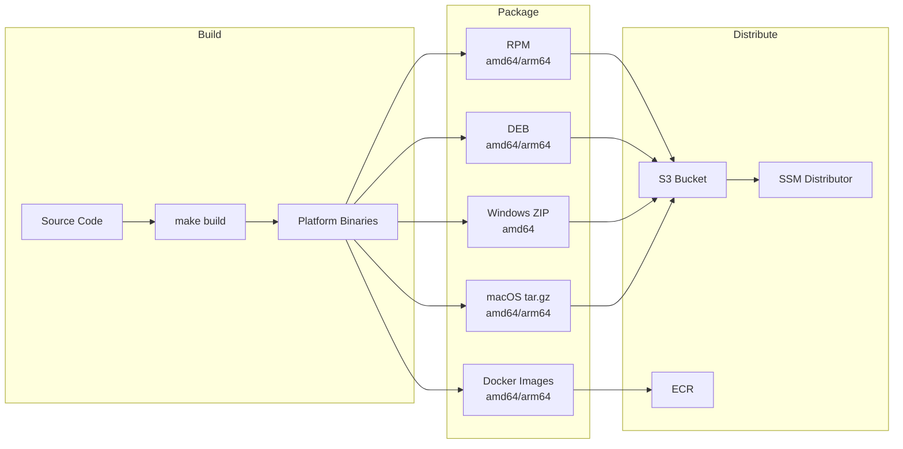
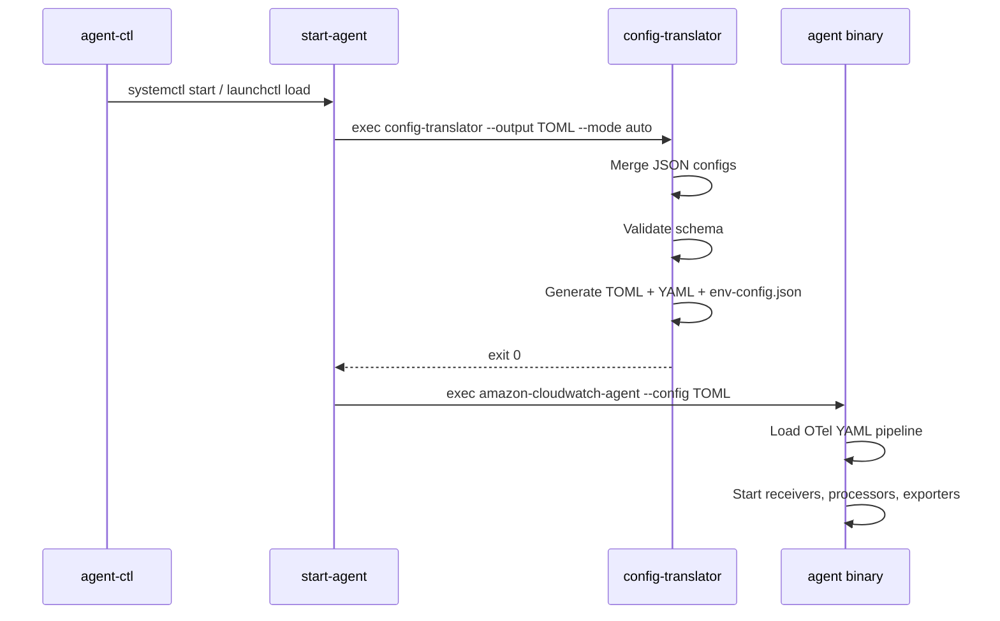
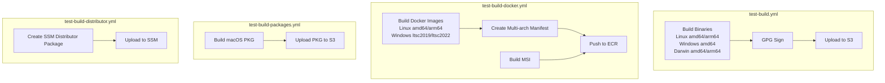

# Deployment — Packaging, Installation, and Service Management

How the CloudWatch Agent is packaged, installed, and managed as a system service across Linux, macOS, Windows, and containers.

## Overview



## Package Formats

| Format | Platforms | Architectures | Make Target | Script |
|--------|-----------|---------------|-------------|--------|
| RPM | Amazon Linux, RHEL, CentOS | amd64, arm64 | `package-rpm` | `Tools/src/create_rpm.sh` |
| DEB | Debian, Ubuntu | amd64, arm64 | `package-deb` | `Tools/src/create_deb.sh` |
| ZIP | Windows | amd64 | `package-win` | `Tools/src/create_win.sh` |
| tar.gz | macOS | amd64, arm64 | `package-darwin` | `Tools/src/create_darwin.sh` |

The `make release` target runs all four: `package-rpm package-deb package-win package-darwin`.

### Package Contents

Every package includes these binaries and files:

| File | Purpose |
|------|---------|
| `amazon-cloudwatch-agent` | Main agent binary (OTel collector) |
| `start-amazon-cloudwatch-agent` | Launcher — translates config then execs agent |
| `config-translator` | JSON → TOML/YAML config translation CLI |
| `config-downloader` | Fetches config from SSM Parameter Store or S3 |
| `amazon-cloudwatch-agent-config-wizard` | Interactive config generator |
| `workload-discovery` | Detects running workloads (JVM, Tomcat, etc.) |
| `amazon-cloudwatch-agent-ctl` | Control script (start/stop/status/fetch-config) |
| `opentelemetry-jmx-metrics.jar` | OTel JMX metric gatherer for JMX receiver |
| `CWAGENT_VERSION` | Version string file |
| `common-config.toml` | Default common config (credentials, proxy) |
| `amazon-cloudwatch-agent-schema.json` | JSON config schema for validation |
| `LICENSE`, `NOTICE`, `THIRD-PARTY-LICENSES`, `RELEASE_NOTES` | Legal and release docs |

Linux packages additionally include:
- `amazon-cloudwatch-agent.service` — systemd unit file
- `amazon-cloudwatch-agent.conf` — upstart config

macOS packages include:
- `com.amazon.cloudwatch.agent.plist` — launchd plist

Windows packages include:
- `amazon-cloudwatch-agent-ctl.ps1` — PowerShell control script
- `install.ps1` / `uninstall.ps1` — installer scripts

## Installation Paths

### Linux/macOS

```
/opt/aws/amazon-cloudwatch-agent/
├── bin/                          # Binaries + CWAGENT_VERSION + JMX JAR
├── etc/                          # Config files (TOML, YAML, JSON, env-config.json)
│   └── amazon-cloudwatch-agent.d/  # Multi-file JSON config directory
├── logs/                         # Agent log files
├── var/                          # Runtime state (PID files)
├── doc/                          # Schema JSON
├── LICENSE, NOTICE, ...          # Legal files
```

Symlinks created by RPM/DEB packages:
- `/usr/bin/amazon-cloudwatch-agent-ctl` → `bin/amazon-cloudwatch-agent-ctl`
- `/etc/amazon/amazon-cloudwatch-agent` → `etc/`
- `/var/log/amazon/amazon-cloudwatch-agent` → `logs/`
- `/var/run/amazon/amazon-cloudwatch-agent` → `var/`

### Windows

```
%ProgramFiles%\Amazon\AmazonCloudWatchAgent\   # Binaries + scripts
%ProgramData%\Amazon\AmazonCloudWatchAgent\     # Config, logs, state
├── Configs\                                     # Multi-file config directory
├── Logs\
```

### Container

Docker images use the same Linux paths (`/opt/aws/amazon-cloudwatch-agent/`) with `RUN_IN_CONTAINER=True` environment variable. Config is provided via `CW_CONFIG_CONTENT` env var or mounted at `/etc/cwagentconfig/`.

## Service Management

### systemd (Linux)

From `packaging/dependencies/amazon-cloudwatch-agent.service`:

```ini
[Unit]
Description=Amazon CloudWatch Agent
After=network.target

[Service]
Type=simple
ExecStart=/opt/aws/amazon-cloudwatch-agent/bin/start-amazon-cloudwatch-agent
KillMode=process
Restart=on-failure
RestartSec=60s

[Install]
WantedBy=multi-user.target
```

### upstart (Legacy Linux)

From `packaging/linux/amazon-cloudwatch-agent.conf`:

```
start on (runlevel [345] and started network)
stop on (runlevel [!345] or stopping network)
respawn
exec /opt/aws/amazon-cloudwatch-agent/bin/start-amazon-cloudwatch-agent
```

### launchd (macOS)

From `packaging/darwin/com.amazon.cloudwatch.agent.plist` — runs as root, `KeepAlive` with 60-second throttle on failure, `RunAtLoad` enabled.

### Windows Service

Registered as `AmazonCloudWatchAgent` Windows service. Managed via `amazon-cloudwatch-agent-ctl.ps1` which uses `sc.exe` for service control.

## Agent Control Script

The `amazon-cloudwatch-agent-ctl` script (shell on Linux/macOS, PowerShell on Windows) is the primary management interface:

```
amazon-cloudwatch-agent-ctl -a <action> [-m <mode>] [-c <config>] [-s] [-d]
```

| Action | Description |
|--------|-------------|
| `start` | Start the agent (applies default config if none exists) |
| `stop` | Stop the agent process |
| `status` | JSON status output (running/stopped, version, config status) |
| `status-with-workloads` | Status + workload discovery results |
| `fetch-config` | Download and apply config (replaces existing) |
| `append-config` | Append config to existing configs |
| `remove-config` | Remove a specific config source |
| `set-log-level` | Change log level at runtime |
| `prep-restart` | Mark agent for restart (used during upgrades) |
| `cond-restart` | Restart only if `prep-restart` was called |
| `preun` | Stop and disable before uninstall |

Config sources: `default`, `ssm:<parameter-name>`, `file:<path>`, `all` (for remove).

Modes: `ec2`, `onPremise`/`onPrem`, `auto`.

## Startup Flow



The `start-amazon-cloudwatch-agent` binary:
1. Sets up lumberjack log rotation (100MB, 5 backups, 7 days, compressed) — skipped in containers
2. Runs `config-translator` as a subprocess to generate TOML/YAML from JSON config
3. Logs translated config contents
4. Execs the main `amazon-cloudwatch-agent` binary

## RPM Packaging

The RPM spec (`packaging/linux/amazon-cloudwatch-agent.spec`) defines lifecycle hooks:

| Hook | Trigger | Action |
|------|---------|--------|
| `%pre` | Before install/upgrade | Create `cwagent` group and user; on upgrade: `prep-restart` + `stop` |
| `%preun` | Before uninstall | `preun` (stop + disable) |
| `%posttrans` | After install/upgrade | `cond-restart` (restart if was running) |

The `cwagent` user is created as a system user (`useradd -r`) with no home directory, no login shell, in the `cwagent` group.

## DEB Packaging

DEB uses maintainer scripts in `packaging/debian/`:

| Script | Action |
|--------|--------|
| `preinst` | On upgrade: `prep-restart` + `stop`; create `cwagent` user/group |
| `postinst` | On configure: `cond-restart` |
| `prerm` | On remove: `preun` (stop + disable) |

`conffiles` marks `/opt/aws/amazon-cloudwatch-agent/etc/common-config.toml` as a config file (preserved on upgrade).

## Docker Images

Six Dockerfile variants in `amazon-cloudwatch-container-insights/cloudwatch-agent-dockerfile/`:

| Variant | Path | Base Image | Input |
|---------|------|------------|-------|
| `localbin` | `localbin/Dockerfile` | `scratch` (via ubuntu cert stage) | Pre-built binaries from `build/bin/` |
| `localbin` Windows | `localbin/Dockerfile.Windows` | `windows/servercore` | Pre-built binaries from `tmp/windows_amd64/` |
| `source` | `source/Dockerfile` | `scratch` (via golang + ubuntu) | Builds from source inside container |
| `source` Windows | `source/Dockerfile.Windows` | `windows/nanoserver` (via golang) | Builds from source inside container |
| `localal2` | `localal2/Dockerfile` | `scratch` (via amazonlinux) | Local RPM file |
| `localdeb` | `localdeb/Dockerfile` | `scratch` (via ubuntu) | Local DEB file |
| `localmsi` Windows | `localmsi/Dockerfile.Windows` | `windows/nanoserver` (via servercore) | Local MSI file |

All images set `RUN_IN_CONTAINER=True` and use `start-amazon-cloudwatch-agent` as entrypoint (Linux) or CMD (Windows).

The `localbin` variant is the primary development image. Multi-arch builds use `docker buildx`:

```bash
# Build linux/amd64 + linux/arm64
make docker-build

# Build single arch and load into local Docker
make docker-build-amd64
make docker-build-arm64
```

Docker images strip unnecessary binaries (wizard, ctl, config-downloader) since config is provided via environment variables in container deployments.

## CI Release Pipeline



The workflows are reusable (`workflow_call`) and parameterized with S3 bucket paths, ECR repo names, and IAM roles.

## JMX Metrics JAR

The `packaging/opentelemetry-jmx-metrics.jar` is bundled from the [OpenTelemetry Java Contrib](https://github.com/open-telemetry/opentelemetry-java-contrib) project. To update:

1. Run `packaging/update-jmx-jar.sh` (fetches latest release from GitHub)
2. Update SHA and version in `packaging/opentelemetry_jmx_jar_test.go`
3. Verify `jmxreceiver` compatibility in `supported_jars.go`
4. Run integration tests

## Related Docs

- [Build and Tooling](build-and-tooling.md) — Make targets, cross-compilation, CI workflows
- [Configuration](configuration.md) — JSON config, common config, environment variables
- [Config Translation](config-translation.md) — How JSON config becomes OTel YAML
- [Project Structure](project-structure.md) — Binary entry points and package layout
