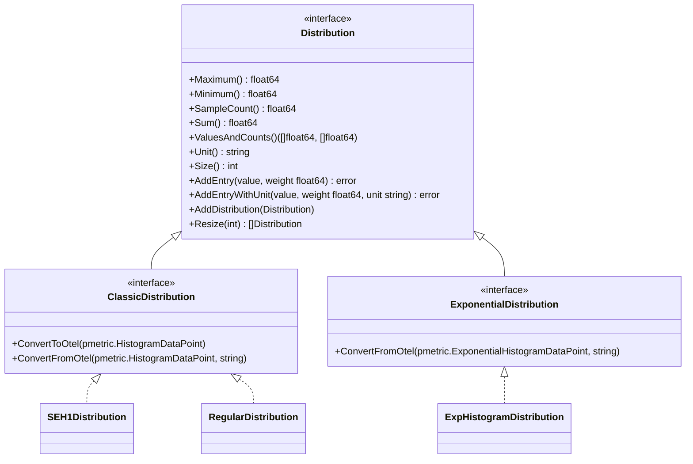

# Domain Model

Shared types, metric representations, constants, and unit mappings used across the CloudWatch Agent.

## Type Hierarchy



## Metric Distribution Types

Package: `metric/distribution/`

The agent uses custom distribution types to aggregate metric values before sending to CloudWatch. The `Distribution` interface is the base, with two sub-interfaces for classic (explicit-bucket) and exponential histograms.

### Distribution Interface

Defined in `metric/distribution/distribution.go`. All distributions track min, max, sum, sample count, and a unit string. The `weight` parameter in `AddEntry`/`AddEntryWithUnit` represents `1/samplingRate` for StatsD-style sampling.

Validation constraints (matching [CloudWatch MetricDatum API](https://docs.aws.amazon.com/AmazonCloudWatch/latest/APIReference/API_MetricDatum.html)):
- Values must not be NaN or Inf
- Values must be between `-2^360` and `2^360`
- Weight must be > 0

### Implementations

| Type | Package | Bucket Key | Use Case |
|---|---|---|---|
| `SEH1Distribution` | `metric/distribution/seh1` | `int16` (log-bucket index) | Default for CloudWatch PutMetricData — logarithmic bucketing with 10% relative error |
| `RegularDistribution` | `metric/distribution/regular` | `float64` (exact value) | Intermediate accumulation — resizes into SEH1 distributions when bucket count exceeds limits |
| `ExpHistogramDistribution` | `metric/distribution/exph` | `int` (OTel exp-histogram offset index) | OTel exponential histogram data points — supports positive, negative, and zero buckets |

The active classic distribution factory is set via the package-level variable:

```go
// metric/distribution/distribution.go
var NewClassicDistribution func() ClassicDistribution
```

This is assigned at startup to either `seh1.NewSEH1Distribution` or `regular.NewRegularDistribution`.

### SEH1 Bucketing

SEH1 (Simple Exponential Histogram, 1-bucket) uses logarithmic bucketing with factor `log(1.1)`. The bucket number for a value is `floor(ln(value) / ln(1.1))`. Zero maps to `math.MinInt16`. This gives ~10% relative error per bucket, matching CloudWatch's native histogram format.

### RegularDistribution Resize

When a `RegularDistribution` exceeds the bucket limit, `Resize()` sorts values and re-buckets them into one or more `SEH1Distribution` instances, splitting when a new value would exceed the size limit.

### OTel Conversion

Both classic types implement `ConvertToOtel`/`ConvertFromOtel` for round-tripping through `pmetric.HistogramDataPoint`. The exponential type converts from `pmetric.ExponentialHistogramDataPoint`. Bucket keys are stored in `ExplicitBounds` (classic) or offset-indexed arrays (exponential).

## OTel Metric Helpers

Package: `internal/metric/`

Generic interfaces and iteration helpers for working with OTel metric data points:

```go
// internal/metric/metric.go

// DataPoint — type constraint for all OTel data point types
type DataPoint[T any] interface {
    pmetric.NumberDataPoint | pmetric.HistogramDataPoint |
        pmetric.ExponentialHistogramDataPoint | pmetric.SummaryDataPoint
    MoveTo(dest T)
    Attributes() pcommon.Map
    // ...
}

// DataPoints — type constraint for OTel slice types
type DataPoints[T DataPoint[T]] interface {
    Len() int
    At(i int) T
    AppendEmpty() T
    RemoveIf(f func(T) bool)
}
```

Key functions:

| Function | Purpose |
|---|---|
| `RangeMetrics(md, fn)` | Iterate all metrics across all resource/scope slices |
| `RangeDataPointAttributes(m, fn)` | Iterate attributes of all data points in a metric (any type) |
| `RangeDataPoints[T](dps, fn)` | Generic iteration over typed data point slices |
| `DecorateMetricName(measurement, fieldKey)` | Join measurement + field with `_` (Linux/macOS) or ` ` (Windows); special-cases `"value"` → measurement only, and service inputs (prometheus) → fieldKey only |

The `Metrics` struct wraps `pmetric.MetricSlice` and provides `AddGaugeMetricDataPoint()` for creating gauge metrics with typed value coercion (float64, int64, bool → int64, byte → int64).

## CloudWatch Unit Mapping

Package: `internal/cloudwatch/`

Converts OTel unit strings ([UCUM](https://unitsofmeasure.org/ucum)) to CloudWatch `StandardUnit` values. Defined in `internal/cloudwatch/unit.go`.

### Conversion Priority

1. Known non-convertible units (e.g. `sessions`, `threads`, `{messages}`) → `None` silently
2. Direct CloudWatch standard unit name match (case-insensitive)
3. Base unit match (`s`, `ms`, `us`, `b`, `by`, `bi`, `%`, `b/s`, `by/s`, `bi/s`)
4. Unique conversions with scaling (`ns` → None, `min` → Seconds×60, `h` → Seconds×3600, `d` → Seconds×86400)
5. Prefix + base unit (e.g. `KiBy` → split into `Ki` prefix + `By` base → Kilobytes with binary→metric scale factor)

### Prefix System

Package: `internal/util/unit/`

| Type | Values | Base |
|---|---|---|
| `MetricPrefix` | k (10³), M (10⁶), G (10⁹), T (10¹²) | Base-10 |
| `BinaryPrefix` | Ki (2¹⁰), Mi (2²⁰), Gi (2³⁰), Ti (2⁴⁰) | Base-2 |

Binary prefixes are converted to metric prefixes with a scale factor: e.g. `KiBy` → `Kilobytes` with scale `1024/1000 = 1.024`.

### Scaled Unit Matrix

| Base Unit | Kilo | Mega | Giga | Tera |
|---|---|---|---|---|
| Bits | Kilobits | Megabits | Gigabits | Terabits |
| Bytes | Kilobytes | Megabytes | Gigabytes | Terabytes |
| Bits/Second | Kilobits/Second | Megabits/Second | Gigabits/Second | Terabits/Second |
| Bytes/Second | Kilobytes/Second | Megabytes/Second | Gigabytes/Second | Terabytes/Second |

## Entity Model

Package: `internal/entity/`

Minimal types for overriding entity attributes in the `awsentity` processor pipeline:

```go
// internal/entity/entity.go
type KeyPair struct {
    Key   string `mapstructure:"key"`
    Value string `mapstructure:"value"`
}

type Transform struct {
    KeyAttributes []KeyPair `mapstructure:"key_attributes"`
    Attributes    []KeyPair `mapstructure:"attributes"`
}
```

`Transform` is used in processor configs to override entity key attributes and attributes that the `awsentity` processor attaches to telemetry data. The entity store extension (`extension/entitystore/`) manages the full entity lifecycle (EC2 instance identity, EKS cluster info, service name resolution).

## Container Insights Constants

Package: `internal/containerinsightscommon/`

Central constant definitions for Container Insights metrics across Kubernetes and ECS.

### Attribute Keys

| Constant | Value | Usage |
|---|---|---|
| `ClusterNameKey` | `"ClusterName"` | EKS/ECS cluster identifier |
| `NodeNameKey` | `"NodeName"` | K8s node name |
| `InstanceIdKey` | `"InstanceId"` | EC2 instance ID |
| `GpuDeviceKey` | `"GpuDevice"` | GPU device identifier |
| `ClusterQueueNameKey` | `"ClusterQueue"` | Kueue cluster queue |

### Metric Name Categories

| Category | Example Constants | Prefix Pattern |
|---|---|---|
| CPU | `CpuTotal`, `CpuUser`, `CpuSystem`, `CpuUtilization`, `CpuRequest`, `CpuLimit` | `cpu_*` |
| Memory | `MemUsage`, `MemWorkingset`, `MemUtilization`, `MemRequest`, `MemLimit` | `memory_*` |
| Network | `NetRxBytes`, `NetTxBytes`, `NetRxErrors`, `NetTxErrors` | `network_*` |
| Filesystem | `FSUsage`, `FSCapacity`, `FSAvailable`, `FSUtilization` | `filesystem_*` |
| Disk I/O | `DiskIOServiceBytesPrefix`, `DiskIORead`, `DiskIOWrite` | `diskio_*` |
| GPU | `GpuUtilization`, `GpuMemUsed`, `GpuTemperature`, `GpuPowerDraw` | `gpu_*` |
| Neuron | `NeuronCoreUtilization`, `NeuronExecutionLatency`, `NeuronHardware` | `neuron*` |
| NVMe EBS | `NvmeReadOpsTotal`, `NvmeWriteBytesTotal`, `NvmeVolumeQueueLength` | `diskio_ebs_*` |
| NVMe Instance Store | `NvmeInstanceStoreReadOpsTotal`, `NvmeInstanceStoreWriteBytesTotal` | `diskio_instance_store_*` |
| Kueue | `KueuePendingWorkloads`, `KueueAdmittedActiveWorkloads` | `kueue_*` |

### Type Constants

Type constants identify the metric source level. The `MetricName()` function in `util.go` maps types to metric name prefixes:

| Type | Prefix | Platform |
|---|---|---|
| `TypeInstance` / `TypeNode` | `instance_` / `node_` | ECS / EKS |
| `TypePod` | `pod_` | K8s |
| `TypeContainer` | `container_` | K8s/ECS |
| `TypeService` | `service_` | K8s |
| `TypeCluster` | `cluster_` | Both |
| `TypeGpuNode` / `TypeGpuPod` / `TypeGpuContainer` | `node_` / `pod_` / `container_` | GPU metrics |
| `TypeClusterQueue` | `cluster_` | Kueue |

Sub-types for resource-specific metrics: `TypeNodeFS`, `TypeNodeNet`, `TypeNodeDiskIO`, `TypePodNet`, `TypeContainerFS`, `TypeContainerDiskIO`, `TypeNodeEBS`, `TypeNodeInstanceStore`.

### Kubernetes Constants

Package: `internal/containerinsightscommon/k8sconst.go`

Pod metadata keys (`PodIdKey`, `PodNameKey`, `ContainerNamekey`, `ContainerIdkey`), status metrics (`RunningPodCount`, `RunningContainerCount`, `NodeCount`), and pod owner types (`ReplicaSet`, `Deployment`, `StatefulSet`, `DaemonSet`, `Job`, `CronJob`).

### ECS Constants

Package: `internal/containerinsightscommon/ecsconst.go`

`ContainerInstanceIdKey` and `RunningTaskCount` for ECS-specific Container Insights.

### NodeCapacity

`NodeCapacity` struct reads CPU core count and memory total from `/rootfs/proc` (via gopsutil) for calculating utilization percentages in containerized environments.

## Logs Common Constants

Package: `internal/logscommon/`

Field keys used in the log collection pipeline:

| Constant | Value | Purpose |
|---|---|---|
| `LogGroupNameTag` | `"log_group_name"` | CloudWatch Logs group |
| `LogStreamNameTag` | `"log_stream_name"` | CloudWatch Logs stream |
| `MultiLineStartField` | `"multi_line_start"` | Multiline log detection flag |
| `OffsetField` | `"offset"` | File read offset tracking |
| `FileNameField` | `"file_name"` | Source file path |
| `LogTimestampField` | `"log_timestamp"` | Parsed timestamp from log line |
| `LogEntryField` | `"value"` | Log line content |
| `LogBackpressureModeKey` | `"backpressure_mode"` | Backpressure strategy (`fd_release`) |

## Structured Logs / EMF Types

Package: `internal/structuredlogscommon/`

Types for CloudWatch Embedded Metric Format (EMF) rule attachment on Telegraf metrics:

```go
// internal/structuredlogscommon/common.go
type MetricRule struct {
    Metrics       []MetricAttr `json:"Metrics"`
    DimensionSets [][]string   `json:"Dimensions"`
    Namespace     string       `json:"Namespace"`
}

type MetricAttr struct {
    Unit string `json:"Unit,omitempty"`
    Name string `json:"Name"`
}
```

Key functions:
- `AttachMetricRule()` — Filters rules against actual metric fields/tags, attaches matching rules via `CloudWatchMetrics` field
- `AttachMetricRuleWithDedup()` — Same with deduplication of overlapping metric/dimension combinations
- `BuildAttributes()` / `BuildMeasurements()` — Extract tags and fields into structured log content map
- `AppendAttributesInFields()` — Stores non-string attributes in fields with a tracking tag

## Agent Version

Package: `internal/version/`

Reads version from `CWAGENT_VERSION` file adjacent to the executable. `Full()` returns a user-agent string: `CWAgent/<version> (<go-version>; <os>; <arch>)`.

## Related Docs

- [Plugins & Pipeline](plugins-pipeline.md) — How metrics flow through the OTel pipeline
- [Configuration](configuration.md) — JSON config schema for metrics/logs/traces sections
- [Config Translation](config-translation.md) — How config maps to pipeline components
