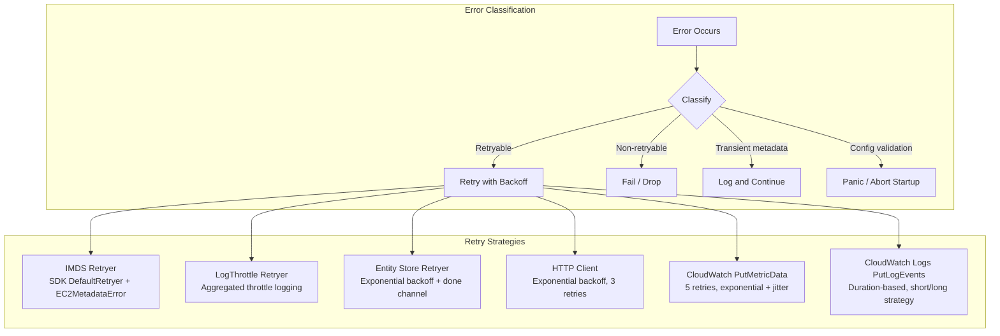
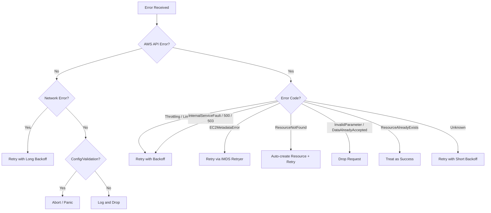

# Error Handling

How the CloudWatch Agent handles errors across subsystems: retry strategies, error classification, propagation through the OTel pipeline, and config validation failures.

## Error Strategy Overview



## IMDS Retryer

`internal/retryer/imdsretryer.go` — Extends the AWS SDK `DefaultRetryer` to retry `EC2MetadataError` codes, which the SDK does not retry by default.

```go
// From internal/retryer/imdsretryer.go
func (r IMDSRetryer) ShouldRetry(req *request.Request) bool {
    shouldRetry := false
    if awsError, ok := req.Error.(awserr.Error); r.DefaultRetryer.ShouldRetry(req) ||
        (ok && awsError != nil && awsError.Code() == "EC2MetadataError") {
        shouldRetry = true
    }
    return shouldRetry
}
```

Key details:
- Default retry count: 1 (configurable via `IMDS_NUMBER_RETRY` env var)
- Used by the translator layer during config translation
- OTel component layer retries come from AWS SDK config settings instead

## Log-Throttled Retryer

`internal/retryer/logthrottle.go` — Wraps `DefaultRetryer` with throttle event aggregation to prevent log flooding during sustained API throttling.

```go
// From internal/retryer/logthrottle.go
func (r *LogThrottleRetryer) ShouldRetry(req *request.Request) bool {
    if req.IsErrorThrottle() {
        te := throttleEvent{Err: req.Error}
        if req.Operation != nil {
            te.Operation = req.Operation.Name
        }
        r.throttleChan <- te
    }
    return r.DefaultRetryer.ShouldRetry(req)
}
```

Behavior:
- Logs throttle events at Info level at most once per minute
- Between reports, logs at Debug level
- On shutdown, reports final aggregated count
- Background goroutine (`watchThrottleEvents`) checks every 5 seconds
- Used by the CloudWatch metrics exporter (`plugins/outputs/cloudwatch/`)

## Entity Store Retryer

`extension/entitystore/retryer.go` — General-purpose retry loop with exponential backoff, jitter on success, and graceful shutdown via `done` channel.

```go
// From extension/entitystore/retryer.go
func (r *Retryer) refreshLoop(updateFunc func() error) int {
    retry := 1
    for {
        if r.maxRetry != -1 && retry > r.maxRetry {
            return retry
        }
        err := updateFunc()
        if err == nil && r.oneTime {
            return retry
        } else if awsErr, ok := err.(awserr.Error); ok &&
            !r.retryAnyError && !retryableErrorMap[awsErr.Code()] {
            return retry  // non-retryable AWS error → stop
        }
        waitDuration := calculateWaitTime(retry-1, err, ...)
        wait := time.NewTimer(waitDuration)
        select {
        case <-r.done:
            wait.Stop()
            return retry
        case <-wait.C:
        }
        if err != nil {
            retry++
        } else {
            retry = 1  // reset on success
        }
    }
}
```

Key features:
- Configurable: `oneTime` (stop after first success), `retryAnyError`, `maxRetry` (-1 for infinite)
- On success: waits random duration in `[successRetryMin, successRetryMax]` seconds before next poll
- On error: exponential backoff from `backoffArray` (capped at last element)
- Only `RequestLimitExceeded` is retryable by default (unless `retryAnyError` is set)
- Shutdown-aware via `select` on `done` channel

## HTTP Client Retryer

`internal/httpclient/httpclient.go` — Simple HTTP GET client with exponential backoff for metadata endpoints.

- 3 retries, 200ms base backoff, capped at 60 seconds
- 1-second request timeout
- 5MB response size limit (guards against unbounded reads)
- Handles chunked responses (unknown `Content-Length`) via `io.LimitReader`
- Used for ECS metadata, IMDS, and other HTTP metadata endpoints

## CloudWatch PutMetricData Error Handling

`plugins/outputs/cloudwatch/cloudwatch.go` — The `WriteToCloudWatch` method retries PutMetricData with error classification:

```go
// From plugins/outputs/cloudwatch/cloudwatch.go
for i := 0; i < c.config.MaxRetryCount; i++ {
    _, err = c.svc.PutMetricData(params)
    if err != nil {
        awsErr, ok := err.(awserr.Error)
        if !ok {
            c.backoffSleep()  // unknown error → backoff and retry
            continue
        }
        switch awsErr.Code() {
        case cloudwatch.ErrCodeLimitExceededFault,
             cloudwatch.ErrCodeInternalServiceFault:
            c.backoffSleep()  // retryable → backoff and retry
            continue
        default:
            c.backoffSleep()  // other AWS error → backoff then break
        }
    } else {
        c.retries = 0  // success → reset counter
    }
    break
}
```

Error classification:
| Error | Action |
|---|---|
| `LimitExceededFault` | Retry with backoff |
| `InternalServiceFault` | Retry with backoff |
| Non-`awserr.Error` | Retry with backoff |
| Other AWS errors (e.g. `InvalidParameterValue`) | Backoff then drop batch |

Backoff: exponential with jitter, base 200ms, capped at 1 minute. Default 5 retries.

Adaptive publish interval: when the `datumBatchChan` buffer fills, the publish interval is halved (minimum 1 second) to reduce burst pressure.

## CloudWatch Logs Error Handling

`plugins/outputs/cloudwatchlogs/internal/pusher/` — Duration-based retry with dual short/long strategies.

### PutLogEvents Retry (`sender.go`)

```go
// From plugins/outputs/cloudwatchlogs/internal/pusher/sender.go
switch e := awsErr.(type) {
case *cloudwatchlogs.ResourceNotFoundException:
    // Re-create log group/stream, then retry
    s.targetManager.InitTarget(batch.Target)
case *cloudwatchlogs.InvalidParameterException,
     *cloudwatchlogs.DataAlreadyAcceptedException:
    // Non-retryable → drop batch
    return
default:
    // Log error, continue to retry
}
```

Non-retryable errors (drop immediately):
- `InvalidParameterException`
- `DataAlreadyAcceptedException`
- Non-AWS errors (cannot cast to `awserr.Error`)

Auto-recovery:
- `ResourceNotFoundException` → re-creates log group and stream via `InitTarget`, then retries

### Retry Wait Strategy (`retry.go`)

Two strategies selected based on error type:

| Strategy | Base Delay | Max Backoff Retries | Used For |
|---|---|---|---|
| Short | 200ms | 5 | Most errors |
| Long | 2s | 2 | Server-side / network errors |

Long strategy triggers:
- HTTP 500 (InternalFailure), 503 (ServiceUnavailable)
- `ServiceUnavailableException`, `ThrottlingException`
- `RequestTimeout`, `ResponseTimeout`
- Connection refused, reset, timeout

Both strategies cap at 1 minute and include jitter (random value in `[d/2, d]`).

Retry continues until `time.Since(startTime) + nextWait > RetryDuration` (default 14 days + 10 minutes for CloudWatch Logs retention).

### Log Group/Stream Creation (`target.go`)

Creation follows a specific sequence:
1. Try `CreateLogStream` → if success or `ResourceAlreadyExistsException`, done
2. If `ResourceNotFoundException` → `CreateLogGroup` → retry `CreateLogStream`
3. `ResourceAlreadyExistsException` on group creation is treated as success

Retention policy updates use a separate backoff (1s base, 10s max, 5 retries) with batch `DescribeLogGroups` (falls back to iterative if batch not supported).

## OTel Pipeline Error Propagation

### Processor Pattern: Log and Continue

Processors generally never return errors. They log issues and pass data through:

```go
// Typical processor pattern (ec2tagger, gpuattributes, awsentity)
func (p *processor) processMetrics(ctx context.Context, md pmetric.Metrics) (pmetric.Metrics, error) {
    // Process metrics, log warnings for individual issues
    // Always return (md, nil) — never propagate errors
    return md, nil
}
```

This prevents a single bad metric from blocking the entire pipeline.

### Receiver Pattern: Scrape Errors

Receivers return errors from `scrape()` which the OTel scrape controller handles:

```go
// From receiver/adapter/receiver.go
func (r *AdaptedReceiver) scrape(_ context.Context) (pmetric.Metrics, error) {
    if err := r.input.Input.Gather(r.accumulator); err != nil {
        r.accumulator.AddError(err)
        return pmetric.Metrics{}, err  // error propagated to scrape controller
    }
    return r.accumulator.GetOtelMetrics(), nil
}
```

The NVMe receiver takes a different approach — it logs individual device failures at Debug level and continues scraping other devices, only returning an error if the entire device enumeration fails.

### Extension Pattern: Background Errors

Extensions start background goroutines that handle their own errors internally:

```go
// From extension/entitystore/extension.go
func (e *EntityStore) Start(ctx context.Context, host component.Host) error {
    // Start returns nil — errors are handled in background goroutines
    go e.ec2Info.initEc2Info()  // retries internally with 1-minute waits
    go e.serviceprovider.startServiceProvider()  // uses Retryer
    e.ready.Store(true)
    return nil
}
```

Extensions never fail startup. They mark themselves as `ready` immediately and populate data asynchronously. Consumers check the `ready` flag or get zero-values until data is available.

## Config Translation Errors

`translator/` — Config validation errors abort the agent with `log.Panic`.

### Schema Validation

```go
// From translator/cmdutil/translatorutil.go
func checkSchema(inputJsonMap map[string]interface{}) {
    result, err := RunSchemaValidation(inputJsonMap)
    if err != nil {
        log.Panicf("E! Failed to run schema validation because of %v", err)
    }
    if !result.Valid() {
        // Collect all errors with paths
        for _, errorDetail := range result.Errors() {
            translator.AddErrorMessages(path, errorDetail.Description())
        }
        log.Panic("E! Invalid Json input schema.")
    }
}
```

### Translation Error Accumulation

The translator uses global `ErrorMessages` and `InfoMessages` slices (`translator/isValid.go`):

```go
var ErrorMessages = []string{}

func AddErrorMessages(path, message string) {
    errorMessage := fmt.Sprintf("Under path : %s | Error : %s", path, message)
    ErrorMessages = append(ErrorMessages, errorMessage)
}

func IsTranslateSuccess() bool {
    return len(ErrorMessages) == 0
}
```

Translation rules call `AddErrorMessages` for validation failures. After all rules run, `IsTranslateSuccess()` determines if the agent should start.

## Startup Fatal Errors

The main agent binary (`cmd/amazon-cloudwatch-agent/`) uses `log.Fatal` for unrecoverable startup errors:
- Failed to run the OTel collector service
- Failed to parse command-line flags
- Failed to load configuration files

Other binaries (config wizard, config downloader) use `log.Panic` for config processing failures.

## Decision Tree: When to Retry vs Fail



## Summary of Retry Parameters

| Subsystem | Max Retries | Base Delay | Max Delay | Jitter |
|---|---|---|---|---|
| IMDS Retryer | 1 (env configurable) | SDK default | SDK default | SDK default |
| LogThrottle Retryer | SDK default (3) | SDK default | SDK default | SDK default |
| Entity Store Retryer | Configurable (-1 = ∞) | From backoff array | Last array element | Random `[min, max]` on success |
| HTTP Client | 3 | 200ms | 60s | None |
| PutMetricData | 5 | 200ms | 1 min | `[d/2, d]` |
| PutLogEvents (short) | Duration-based | 200ms | 1 min | `[d/2, d]` |
| PutLogEvents (long) | Duration-based | 2s | 1 min | `[d/2, d]` |
| Log group/stream creation | 5 | 1s | 10s | `[d/2, d]` |
| EC2 metadata (entitystore) | ∞ (until shutdown) | 1 min fixed | 1 min fixed | None |
| EC2 tag/volume refresh | ∞ (periodic ticker) | Configurable interval | — | Host-based |

## Related Docs

- [Concurrency](concurrency.md) — Shutdown patterns and done channels used by retryers
- [Plugins & Pipeline](plugins-pipeline.md) — OTel component lifecycle (Start/Shutdown)
- [Configuration](configuration.md) — Config validation and schema checking
- [Telemetry](telemetry.md) — Agent health reporting of errors
