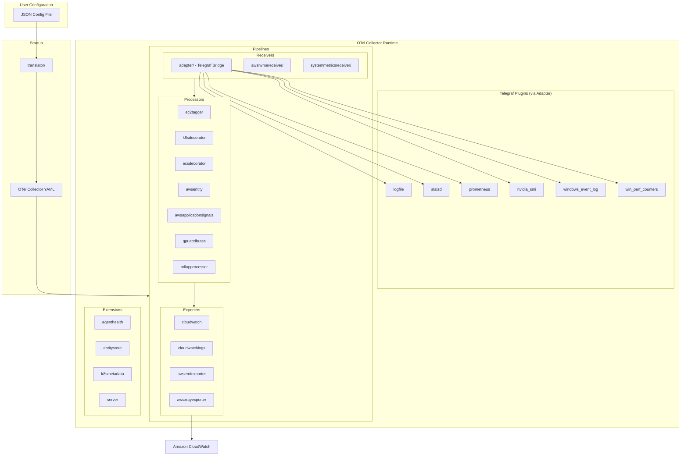

# Architecture Overview

Amazon CloudWatch Agent is a Go-based telemetry agent built on the OpenTelemetry Collector framework. It collects system metrics, logs, custom metrics (StatsD/collectd), and traces from EC2 instances, on-premises servers, and containers (EKS/ECS). A Telegraf adapter receiver bridges legacy Telegraf plugins into the OTel pipeline. User-facing JSON configuration is translated into OTel collector YAML by the translator package at startup.

## System Diagram



## Key Concepts

| Concept | Description |
|---|---|
| OTel Collector | The agent runs as an OpenTelemetry Collector with custom components |
| Telegraf Adapter | `receiver/adapter/` wraps Telegraf input plugins as OTel receivers |
| Translator | `translator/` converts user JSON config into OTel collector pipeline YAML |
| Plugins | `plugins/` contains Telegraf-style inputs, outputs, and processors |
| Extensions | `extension/` provides cross-cutting concerns (health, entity metadata, K8s metadata, HTTP server) |
| Default Components | `service/defaultcomponents/` registers all OTel component factories |
| Config Schema | `translator/config/schema.json` defines the JSON config schema |
| Workload Discovery | `cmd/workload-discovery/` detects running workloads (JVM, Tomcat, Kafka, NVIDIA GPU) |

## Directory Structure

```
cmd/                          # Binary entry points
├── amazon-cloudwatch-agent/  #   Main agent binary (OTel collector startup)
├── start-amazon-cloudwatch-agent/ # Agent launcher (runs translator then agent)
├── config-translator/        #   JSON→OTel config translator CLI
├── config-downloader/        #   SSM/S3 config fetcher
├── amazon-cloudwatch-agent-config-wizard/ # Interactive config wizard
├── workload-discovery/       #   Workload detection binary
└── xray-migration/           #   X-Ray daemon migration tool
plugins/                      # Telegraf-style plugins
├── inputs/                   #   Data sources (logfile, statsd, prometheus, nvidia_smi, win_perf_counters, windows_event_log)
├── outputs/                  #   Destinations (cloudwatch, cloudwatchlogs)
└── processors/               #   Data transforms (ec2tagger, k8sdecorator, ecsdecorator, awsentity, awsapplicationsignals, gpuattributes, kueueattributes, prometheusadapter)
receiver/                     # OTel receivers
├── adapter/                  #   Wraps Telegraf plugins as OTel receivers
├── awsnvmereceiver/          #   NVMe disk metrics
└── systemmetricsreceiver/    #   CPU, memory, disk, ethtool, JVM metrics
extension/                    # OTel extensions
├── agenthealth/              #   Agent health reporting to CloudWatch
├── entitystore/              #   EC2/EKS entity metadata
├── k8smetadata/              #   Kubernetes pod/node metadata
└── server/                   #   Local HTTP server for status/config
translator/                   # Config translation engine
├── translate/                #   JSON config → OTel pipeline rules (metrics, logs, traces, agent, otel)
├── tocwconfig/               #   Final OTel config assembly (toml, yaml, env)
├── jsonconfig/               #   JSON config merge logic
├── config/                   #   Schema, defaults, OS config
├── cmdutil/                  #   CLI translation utilities
├── context/                  #   Translation context
└── util/                     #   SDK, ECS, EKS, EC2 detection utilities
processor/                    # OTel processors
└── rollupprocessor/          #   Metric rollup aggregation
internal/                     # Shared internal packages
├── detector/                 #   Workload detection (JVM, Tomcat, Kafka, NVIDIA)
├── k8sCommon/                #   Kubernetes client utilities
├── containerinsightscommon/  #   Container Insights constants
├── state/                    #   State management
├── retryer/                  #   IMDS retry logic
├── publisher/                #   Non-blocking pub/sub
├── tls/                      #   TLS certificate watching
├── cloudwatch/               #   CloudWatch unit utilities
├── ec2metadataprovider/      #   EC2 metadata access
└── util/                     #   Collections, hash, config, security helpers
service/                      # OTel service wiring
├── defaultcomponents/        #   Component factory registration
├── configprovider/           #   Config provider flags
└── registry/                 #   Plugin registry
cfg/                          # Configuration
├── aws/                      #   AWS credentials and SDK config
├── commonconfig/             #   Common agent config (TOML)
└── envconfig/                #   Environment variable config
metric/                       # Metric types and distribution
tool/                         # CLI tools and utilities
├── wizard/                   #   Config wizard logic
├── downloader/               #   Config downloader logic
├── translator/               #   Translator tool wrapper
├── clean/                    #   Integration test cleanup utilities
├── xraydaemonmigration/      #   X-Ray daemon config migration
└── processors/               #   Wizard question processors
packaging/                    # RPM, DEB, Windows, macOS packaging
```

## Key Files

| File | Purpose |
|---|---|
| `cmd/amazon-cloudwatch-agent/amazon-cloudwatch-agent.go` | Main agent entry point; starts OTel collector |
| `cmd/start-amazon-cloudwatch-agent/start-amazon-cloudwatch-agent.go` | Launcher that runs config translation then starts the agent |
| `service/defaultcomponents/components.go` | Registers all OTel receiver, processor, exporter, and extension factories |
| `translator/cmdutil/translatorutil.go` | Core config translation orchestration |
| `translator/tocwconfig/tocwconfig_test.go` | Comprehensive translation integration tests |
| `translator/config/schema.json` | JSON config schema definition |
| `receiver/adapter/receiver.go` | Telegraf-to-OTel adapter receiver |
| `plugins/plugins.go` | Telegraf plugin registration |
| `cfg/aws/credentials.go` | AWS credential chain setup |
| `Makefile` | Build, test, lint, format, and packaging targets |
| `.golangci.yml` | Linter configuration (gosec, misspell, nonamedreturns, revive) |
| `CWAGENT_VERSION` | Agent version file |

## Related Architecture Docs

Detailed documentation for each subsystem:

| Document | Description |
|---|---|
| [Scope and Boundaries](SCOPE.md) | What this repo owns and does not own; upstream relationships |
| [Build System and Tooling](build-and-tooling.md) | Make targets, cross-compilation, CI workflows, linting |
| [Project Structure](project-structure.md) | Go module layout, binary entry points, dual plugin system |
| [Configuration](configuration.md) | JSON config schema, common config TOML, env vars, credential chain |
| [Config Translation](config-translation.md) | JSON→OTel YAML translation engine, legacy and OTel rule paths |
| [Plugins and OTel Pipeline](plugins-pipeline.md) | OTel component factory pattern, Telegraf adapter, component inventory |
| [Domain Model](domain-model.md) | Metric distributions, CloudWatch units, entity model, Container Insights constants |
| [Testing](testing.md) | Factory tests, golden file tests, test helpers, race detection |
| [Concurrency](concurrency.md) | Publisher pattern, channel pipelines, background refresh, known races |
| [Error Handling](error-handling.md) | Retry strategies, error classification, failure modes |
| [Telemetry](telemetry.md) | Agent health extension, stats providers, user-agent, logging |
| [Deployment](deployment.md) | RPM/DEB/ZIP/tar/Docker packaging, service management, release pipeline |
| [Recipes](recipes.md) | Step-by-step guides, boilerplate templates, decision trees |
