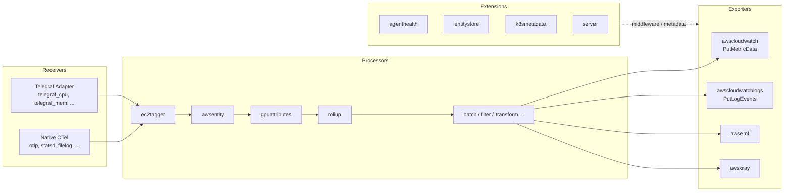
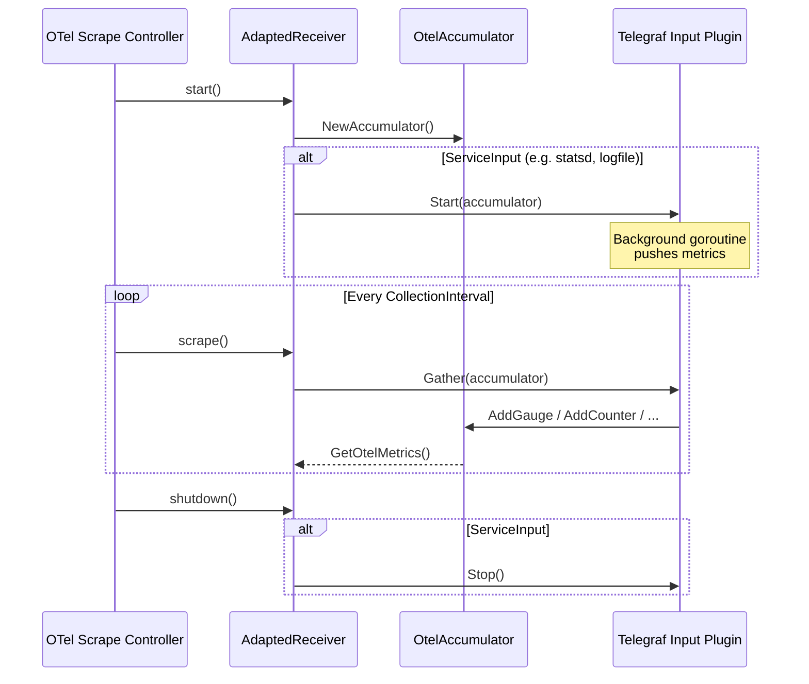

# OTel Pipeline & Plugin System

The CloudWatch Agent runs as an OpenTelemetry Collector with a dual plugin system: native OTel components and Telegraf plugins bridged via an adapter receiver. All components are registered in `service/defaultcomponents/components.go` and wired into pipelines by the config translator at startup.

## Pipeline Architecture



Pipelines are defined in the translated OTel YAML config. Each pipeline specifies a signal type (metrics, logs, or traces) and chains receivers → processors → exporters. Extensions run independently and provide cross-cutting services (health reporting, metadata, HTTP server).

## OTel Component Factory Pattern

Every native OTel component follows the same three-file pattern:

| File | Purpose |
|------|---------|
| `config.go` | Config struct implementing `component.Config` with `mapstructure` tags and optional `Validate()` |
| `factory.go` | `NewFactory()` function, `createDefaultConfig()`, and `create*Component()` constructor |
| `processor.go` / `receiver.go` / `extension.go` | Component implementation with `Start`, `Shutdown`, and signal-specific methods |

### Factory Structure

Every factory follows this template:

```go
// factory.go
var TypeStr, _ = component.NewType("mycomponent")

func NewFactory() processor.Factory {
    return processor.NewFactory(
        TypeStr,
        createDefaultConfig,
        processor.WithMetrics(createMetricsProcessor, stability),
    )
}

func createDefaultConfig() component.Config {
    return &Config{}
}

func createMetricsProcessor(
    ctx context.Context,
    set processor.Settings,
    cfg component.Config,
    nextConsumer consumer.Metrics,
) (processor.Metrics, error) {
    p := newMyProcessor(cfg.(*Config), set.Logger)
    return processorhelper.NewMetrics(ctx, set, cfg, nextConsumer,
        p.processMetrics,
        processorhelper.WithCapabilities(consumer.Capabilities{MutatesData: true}),
        processorhelper.WithStart(p.Start),
        processorhelper.WithShutdown(p.Shutdown))
}
```

The pattern varies by component type:

| Type | Helper | Signal Options |
|------|--------|----------------|
| Receiver | `scraperhelper.NewMetricsController` | `receiver.WithMetrics` |
| Processor | `processorhelper.NewMetrics` / `NewTraces` | `processor.WithMetrics`, `processor.WithTraces` |
| Exporter | `exporterhelper.NewMetrics` | `exporter.WithMetrics` |
| Extension | Direct `extension.NewFactory` | Single `createExtension` function |

### Config Pattern

Config structs embed standard configs and use `mapstructure` tags for YAML deserialization:

```go
// config.go
type Config struct {
    scraperhelper.ControllerConfig `mapstructure:",squash"`
    Region string `mapstructure:"region"`
}

var _ component.Config = (*Config)(nil)

func (c *Config) Validate() error {
    if c.Region == "" {
        return errors.New("'region' must be set")
    }
    return nil
}
```

## Telegraf Adapter Bridge

The adapter in `receiver/adapter/` wraps Telegraf input plugins as OTel receivers using the scrape controller pattern.



### How It Works

1. `Adapter.NewReceiverFactory(telegrafInputName)` creates an OTel `receiver.Factory` with type `telegraf_<name>` (e.g., `telegraf_cpu`, `telegraf_mem`)
2. The factory's `createMetricsReceiver` looks up the matching `models.RunningInput` from the parsed Telegraf config and calls `Init()` on it
3. An `AdaptedReceiver` wraps the Telegraf input with three lifecycle methods:
   - `start` — Creates an `OtelAccumulator` and calls `Start()` on service inputs (background plugins like statsd)
   - `scrape` — Calls `Gather()` on the input, which populates the accumulator, then returns `GetOtelMetrics()`
   - `shutdown` — Calls `Stop()` on service inputs
4. The `OtelAccumulator` implements `telegraf.Accumulator` and converts Telegraf metrics to OTel `pmetric.Metrics`

### Telegraf Plugin Registration

Telegraf plugins register via `init()` functions and are activated by blank imports in `plugins/plugins.go`:

```go
// plugins/inputs/logfile/logfile.go
func init() {
    inputs.Add("logfile", func() telegraf.Input { return &LogFile{} })
}

// plugins/plugins.go
import _ "github.com/aws/amazon-cloudwatch-agent/plugins/inputs/logfile"
```

## Registered Components

### Receivers (17)

| Component | Source | Type |
|-----------|--------|------|
| `awscontainerinsightreceiver` | upstream contrib | Native OTel |
| `awscontainerinsightskueuereceiver` | upstream contrib | Native OTel |
| `awsecscontainermetricsreceiver` | upstream contrib | Native OTel |
| `awsnvmereceiver` | `receiver/awsnvmereceiver/` | Native OTel |
| `awsxrayreceiver` | upstream contrib | Native OTel |
| `filelog` | upstream contrib | Native OTel |
| `jaeger` | upstream contrib | Native OTel |
| `jmx` | upstream contrib | Native OTel |
| `kafka` | upstream contrib | Native OTel |
| `nop` | upstream core | Native OTel |
| `otlp` | upstream core | Native OTel |
| `prometheus` | upstream contrib | Native OTel |
| `statsd` | upstream contrib | Native OTel |
| `systemmetrics` | `receiver/systemmetricsreceiver/` | Native OTel |
| `tcplog` | upstream contrib | Native OTel |
| `udplog` | upstream contrib | Native OTel |
| `zipkin` | upstream contrib | Native OTel |

Additionally, Telegraf inputs are bridged as `telegraf_*` receivers at runtime (e.g., `telegraf_cpu`, `telegraf_mem`, `telegraf_disk`, `telegraf_logfile`, `telegraf_statsd`).

### Processors (25)

| Component | Source | Signal |
|-----------|--------|--------|
| `awsapplicationsignals` | `plugins/processors/awsapplicationsignals/` | Metrics + Traces |
| `awsentity` | `plugins/processors/awsentity/` | Metrics |
| `ec2tagger` | `plugins/processors/ec2tagger/` | Metrics |
| `gpuattributes` | `plugins/processors/gpuattributes/` | Metrics |
| `kueueattributes` | `plugins/processors/kueueattributes/` | Metrics |
| `prometheusadapter` | `plugins/processors/prometheusadapter/` | Metrics |
| `rollup` | `processor/rollupprocessor/` | Metrics |
| `attributes` | upstream contrib | — |
| `batch` | upstream core | — |
| `cumulativetodelta` | upstream contrib | — |
| `deltatocumulative` | upstream contrib | — |
| `deltatorateprocessor` | upstream contrib | — |
| `filter` | upstream contrib | — |
| `groupbyattrs` | upstream contrib | — |
| `groupbytrace` | upstream contrib | — |
| `k8sattributes` | upstream contrib | — |
| `memorylimiter` | upstream core | — |
| `metricsgeneration` | upstream contrib | — |
| `metricstransform` | upstream contrib | — |
| `probabilisticsampler` | upstream contrib | — |
| `resource` | upstream contrib | — |
| `resourcedetection` | upstream contrib | — |
| `span` | upstream contrib | — |
| `tailsampling` | upstream contrib | — |
| `transform` | upstream contrib | — |

Telegraf-style processors (`k8sdecorator`, `ecsdecorator`) run inside the adapter pipeline and are not registered as OTel processors. They use `processors.Add()` and implement `telegraf.Processor`.

### Exporters (7)

| Component | Source | Notes |
|-----------|--------|-------|
| `awscloudwatch` | `plugins/outputs/cloudwatch/` | PutMetricData — dual-interface (see below) |
| `awscloudwatchlogs` | upstream contrib | PutLogEvents |
| `awsemf` | upstream contrib | Embedded Metric Format |
| `awsxray` | upstream contrib | X-Ray traces |
| `debug` | upstream core | Debug logging |
| `nop` | upstream core | No-op |
| `prometheusremotewrite` | upstream contrib | Prometheus remote write |

### Extensions (11)

| Component | Source | Notes |
|-----------|--------|-------|
| `agenthealth` | `extension/agenthealth/` | Self-reports health via AWS middleware handlers |
| `entitystore` | `extension/entitystore/` | EC2/EKS entity metadata — singleton accessor |
| `k8smetadata` | `extension/k8smetadata/` | Kubernetes pod/service metadata — singleton accessor |
| `server` | `extension/server/` | Local HTTPS server for status queries |
| `awsproxy` | upstream contrib | X-Ray proxy |
| `ecsobserver` | upstream contrib | ECS service discovery |
| `file_storage` | upstream contrib | Persistent storage |
| `health_check` | upstream contrib | Health check endpoint |
| `pprof` | upstream contrib | Go profiling |
| `sigv4auth` | upstream contrib | SigV4 authentication |
| `zpages` | upstream core | Debug pages |

## Dual-Interface Pattern: CloudWatch Exporter

The CloudWatch output (`plugins/outputs/cloudwatch/`) implements both interfaces:

- `exporter.Metrics` (OTel) — `ConsumeMetrics()`, `Start()`, `Shutdown()`, `Capabilities()`
- `telegraf.Output` (Telegraf) — `Connect()`, `Close()`, `Write()` (no-op stubs)

The Telegraf interface stubs exist because the package registers via `outputs.Add("cloudwatch", ...)` in `init()`, but the actual data flow uses the OTel exporter path. The `NewFactory()` in `factory.go` creates the OTel exporter that calls `ConsumeMetrics` → `ConvertOtelMetrics` → aggregation → `PutMetricData`.

## Extension Lifecycle

Extensions implement `extension.Extension` (which embeds `component.Component` with `Start`/`Shutdown`). Two patterns exist:

### Singleton Extensions

`entitystore` and `k8smetadata` use a package-level singleton with a mutex-protected accessor:

```go
// factory.go
var entityStore *EntityStore

func GetEntityStore() *EntityStore {
    mutex.RLock()
    defer mutex.RUnlock()
    if entityStore != nil && entityStore.ready.Load() {
        return entityStore
    }
    return nil
}

func createExtension(_ context.Context, settings extension.Settings, cfg component.Config) (extension.Extension, error) {
    mutex.Lock()
    defer mutex.Unlock()
    entityStore = &EntityStore{logger: settings.Logger, config: cfg.(*Config)}
    return entityStore, nil
}
```

Processors access these via `GetEntityStore()` / `GetKubernetesMetadata()` — the extension must be `ready` (started and initialized) before accessors return non-nil.

### Middleware Extensions

`agenthealth` implements `awsmiddleware.Extension`, providing request/response handlers that inject user-agent strings and collect usage stats on AWS API calls. Exporters discover this extension via the `MiddlewareID` config field.

## Decision Tree: Telegraf Plugin vs Native OTel Component

```
Should I create a Telegraf-style plugin or a native OTel component?

├── Is there an existing upstream Telegraf plugin that does what you need?
│   ├── Yes → Use it via blank import in plugins/plugins.go
│   │         (it becomes a telegraf_* receiver via the adapter)
│   └── No ↓
│
├── Does the component need to handle logs or traces?
│   ├── Yes → Native OTel (Telegraf adapter only supports metrics)
│   └── No ↓
│
├── Does it need to participate in the OTel pipeline directly
│   (e.g., access pmetric/plog/ptrace types, use OTel extensions)?
│   ├── Yes → Native OTel
│   └── No ↓
│
├── Is it a simple scrape-based metric collector?
│   ├── Yes → Either works, but prefer native OTel for new code
│   └── No ↓
│
└── Default → Native OTel component
    (All new components should be native OTel unless
     wrapping an existing Telegraf plugin)
```

## Related Docs

- [Project Structure](project-structure.md) — Package layout and dual registration system
- [Config Translation](config-translation.md) — How JSON config maps to OTel pipeline YAML
- [Configuration](configuration.md) — JSON config schema and environment variables
- [Architecture Overview](overview.md) — High-level system diagram
