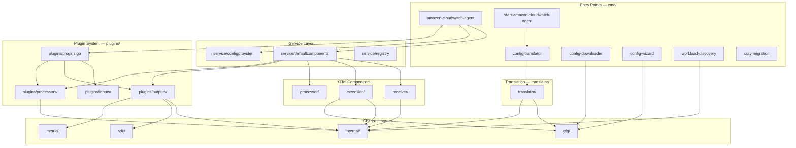

# Project Structure

The CloudWatch Agent is a single Go module (`github.com/aws/amazon-cloudwatch-agent`) with a vendored dependency tree. It has a dual plugin architecture: Telegraf-style plugins registered via side-effect imports in `plugins/plugins.go`, and native OTel components registered as factories in `service/defaultcomponents/components.go`.

## Go Module

```
module github.com/aws/amazon-cloudwatch-agent
go 1.25.7
```

The module replaces upstream Telegraf with an AWS fork (`github.com/aws/telegraf`). All dependencies are vendored in `vendor/`.

## Package Dependency Flow



## Binary Entry Points — `cmd/`

Seven binaries are built from `cmd/`:

| Binary | Source | Purpose |
|---|---|---|
| `amazon-cloudwatch-agent` | `cmd/amazon-cloudwatch-agent/` | Main agent binary; starts the OTel Collector with custom components |
| `start-amazon-cloudwatch-agent` | `cmd/start-amazon-cloudwatch-agent/` | Launcher that runs config translation, then exec's the agent |
| `config-translator` | `cmd/config-translator/` | CLI that converts JSON config → OTel YAML/TOML/env |
| `config-downloader` | `cmd/config-downloader/` | Fetches config from SSM Parameter Store or S3 |
| `amazon-cloudwatch-agent-config-wizard` | `cmd/amazon-cloudwatch-agent-config-wizard/` | Interactive config wizard |
| `workload-discovery` | `cmd/workload-discovery/` | Detects running workloads (JVM, Tomcat, Kafka, NVIDIA GPU) |
| `xray-migration` | `cmd/xray-migration/` | Migrates X-Ray daemon config to CW Agent config |

The typical startup flow is: `start-amazon-cloudwatch-agent` → `config-translator` → `amazon-cloudwatch-agent`.

## Dual Plugin Registration

The agent has two parallel registration systems that coexist at runtime:

### Telegraf Plugins — `plugins/plugins.go`

Side-effect imports register Telegraf plugins into the global Telegraf registry. These plugins are wrapped by the adapter receiver (`receiver/adapter/`) to participate in the OTel pipeline.

```go
// plugins/plugins.go — side-effect imports
_ "github.com/aws/amazon-cloudwatch-agent/plugins/inputs/logfile"
_ "github.com/aws/amazon-cloudwatch-agent/plugins/inputs/statsd"
_ "github.com/influxdata/telegraf/plugins/inputs/cpu"
_ "github.com/influxdata/telegraf/plugins/inputs/mem"
```

Registered plugins include both custom CW Agent inputs (`logfile`, `statsd`, `prometheus`, `nvidia_smi`, `win_perf_counters`, `windows_event_log`) and upstream Telegraf inputs (`cpu`, `disk`, `diskio`, `ethtool`, `mem`, `net`, `processes`, `procstat`, `socket_listener`, `swap`). Telegraf-style processors (`ecsdecorator`, `k8sdecorator`, `prometheusadapter`) and outputs (`cloudwatch`, `cloudwatchlogs`) are also registered here.

### OTel Components — `service/defaultcomponents/components.go`

The `Factories()` function returns all OTel component factories grouped by type:

| Type | Count | Examples |
|---|---|---|
| Receivers | 17 | `otlpreceiver`, `awscontainerinsightreceiver`, `awsnvmereceiver`, `systemmetricsreceiver`, `jmxreceiver`, `prometheusreceiver` |
| Processors | 25 | `ec2tagger`, `awsentity`, `awsapplicationsignals`, `gpuattributes`, `kueueattributes`, `rollupprocessor`, `batchprocessor` |
| Exporters | 7 | `cloudwatch` (custom), `awsemfexporter`, `awsxrayexporter`, `awscloudwatchlogsexporter`, `prometheusremotewriteexporter` |
| Extensions | 11 | `agenthealth`, `entitystore`, `k8smetadata`, `server`, `awsproxy`, `sigv4authextension` |

Components from this repo (custom) vs upstream OTel Collector Contrib are mixed in the same factory map.

### How They Connect

The `receiver/adapter/` package bridges the two systems. It wraps each Telegraf `Input` plugin as an OTel receiver using a scrape controller pattern:

1. `Start` — initializes an `OtelAccumulator` and starts service inputs
2. `Scrape` — calls `input.Gather(accumulator)` to collect Telegraf metrics, converts to `pmetric.Metrics`
3. `Shutdown` — stops service inputs

## Plugin Directories — `plugins/`

```
plugins/
├── plugins.go                    # Telegraf plugin registration (side-effect imports)
├── inputs/                       # Data source plugins
│   ├── logfile/                  #   Log file tailing (complex: tail, globpath, constants, filter)
│   ├── statsd/                   #   StatsD protocol metrics
│   ├── prometheus/               #   Prometheus scraping (target allocator, metrics handler)
│   ├── nvidia_smi/               #   NVIDIA GPU metrics (schema v11/v12)
│   ├── win_perf_counters/        #   Windows performance counters (PDH API)
│   └── windows_event_log/        #   Windows event log (service monitor)
├── outputs/                      # Destination plugins
│   ├── cloudwatch/               #   CloudWatch metrics (OTel factory + Telegraf output, aggregator)
│   └── cloudwatchlogs/           #   CloudWatch Logs
└── processors/                   # Data transform plugins
    ├── ec2tagger/                #   EC2 instance tag decoration
    ├── k8sdecorator/             #   Kubernetes metadata decoration (stores, structured logs)
    ├── ecsdecorator/             #   ECS metadata decoration (cgroup, metric rules)
    ├── awsentity/                #   AWS entity attribute injection
    ├── awsapplicationsignals/    #   Application Signals processing (rules, config, internal)
    ├── gpuattributes/            #   GPU metric attribute processing
    ├── kueueattributes/          #   Kueue workload attribute processing
    └── prometheusadapter/        #   Prometheus metric adaptation
```

The `cloudwatch` output is notable: it implements both the Telegraf `Output` interface (registered in `plugins/plugins.go`) and the OTel `exporter.Factory` interface (registered in `components.go`). It has `factory.go`, `config.go`, and `convert_otel.go` for the OTel side.

## OTel Receivers — `receiver/`

```
receiver/
├── adapter/                      # Telegraf-to-OTel bridge
│   ├── receiver.go               #   AdaptedReceiver (start/scrape/shutdown)
│   ├── factory.go                #   Creates receivers per Telegraf input
│   ├── config.go                 #   Adapter config
│   └── accumulator/              #   OtelAccumulator (Telegraf metrics → pmetric)
├── awsnvmereceiver/              # NVMe disk metrics (mdadm-generated)
│   ├── factory.go / config.go / scraper.go
│   ├── internal/                 #   Generated metadata
│   └── metadata.yaml             #   OTel metadata builder spec
└── systemmetricsreceiver/        # CPU, memory, disk, ethtool, JVM metrics
    ├── factory.go / config.go
    ├── scraper_linux.go          #   Linux-specific scraper
    ├── scraper_other.go          #   No-op for non-Linux
    ├── scraper_cpu_linux.go      #   CPU metrics
    ├── scraper_mem_linux.go      #   Memory metrics
    ├── scraper_disk_linux.go     #   Disk metrics
    ├── scraper_ethtool_linux.go  #   Network ethtool metrics
    └── scraper_jvm_linux.go      #   JVM metrics via /proc
```

## OTel Extensions — `extension/`

```
extension/
├── agenthealth/                  # Self-reports agent health to CloudWatch
│   ├── factory.go / config.go / extension.go
│   ├── handler/                  #   Stats and user-agent handlers
│   └── metadata/                 #   Agent metadata
├── entitystore/                  # EC2/EKS entity metadata cache
│   ├── factory.go / config.go / extension.go
│   ├── ec2Info.go / eksInfo.go   #   Platform-specific info
│   ├── serviceprovider.go        #   Service name resolution
│   └── retryer.go                #   Retry logic for metadata fetches
├── k8smetadata/                  # Kubernetes pod/node metadata
│   ├── factory.go / config.go / extension.go
│   └── README.md
└── server/                       # Local HTTP server for status/config queries
    ├── factory.go / config.go / extension.go
    └── testdata/
```

## OTel Processor — `processor/`

```
processor/
└── rollupprocessor/              # Metric rollup aggregation
    ├── factory.go / config.go / processor.go
    ├── cache.go                  #   Rollup cache
    └── testdata/
```

This is the only processor at the top level. Most processors live under `plugins/processors/` because they also serve as Telegraf processors or follow the same pattern.

## Translator — `translator/`

The translator converts user JSON config into OTel Collector pipeline configuration. It has two translation paths: legacy Telegraf rules and OTel pipeline rules.

```
translator/
├── rule.go                       # Rule interface
├── processRuleToApply.go         # Apply rule to config section
├── processNoRuleToApply.go       # Pass-through when no rule matches
├── processDefaultConfig.go       # Apply default config values
├── processRuleToApplyAndMerge.go # Apply rule and merge results
├── cmdutil/                      # CLI translation orchestration
│   └── translatorutil.go         #   Main translation entry point
├── translate/                    # Translation rules
│   ├── translate.go              #   Legacy translation dispatcher
│   ├── agent/                    #   Agent section rules
│   ├── metrics/                  #   Metrics section rules (legacy)
│   ├── logs/                     #   Logs section rules (legacy)
│   ├── traces/                   #   Traces section rules (legacy)
│   ├── globaltags/               #   Global tags rules
│   ├── csm/                      #   CSM rules
│   ├── util/                     #   Translation utilities
│   └── otel/                     #   OTel pipeline translation
│       ├── translate_otel.go     #     OTel translation entry point
│       ├── common/               #     Shared translation helpers
│       ├── pipeline/             #     Pipeline assembly (host, jmx, containerinsights, xray, emf_logs, applicationsignals, prometheus, systemmetrics, nop)
│       ├── receiver/             #     Receiver config translators (adapter, otlp, jmx, prometheus, awscontainerinsight, awsnvme, systemmetrics, tcplog, udplog, awsxray, awscontainerinsightskueue)
│       ├── processor/            #     Processor config translators (18 processors)
│       ├── exporter/             #     Exporter config translators (awsemf, awscloudwatchlogs, awscloudwatch, awsxray, prometheusremotewrite, debug)
│       └── extension/            #     Extension config translators (agenthealth, entitystore, server, k8smetadata, awsproxy, sigv4auth, ecsobserver)
├── tocwconfig/                   # Final config assembly
│   ├── tocwconfig_test.go        #   Golden file integration tests
│   ├── sampleConfig/             #   Golden file test data (JSON → YAML/TOML/conf)
│   ├── totomlconfig/             #   TOML output
│   ├── toyamlconfig/             #   YAML output
│   └── toenvconfig/              #   Environment config output
├── jsonconfig/                   # Multi-file JSON config merge
│   ├── mergeJsonConfig.go        #   Merge logic
│   ├── mergeJsonRule/            #   Merge rules
│   ├── mergeJsonUtil/            #   Merge utilities
│   └── sampleJsonConfig/         #   Sample JSON configs for tests
├── config/                       # Schema and defaults
│   ├── schema.json               #   JSON config schema (54KB)
│   ├── schema.go                 #   Schema validation
│   ├── defaultConfig.go          #   Default config values
│   ├── os.go                     #   OS-specific config
│   ├── mode.go                   #   Config modes (ec2, onPrem, auto)
│   └── envconst.go               #   Environment constants
├── context/                      # Translation context (shared state during translation)
├── registerrules/                # Rule registration
├── flags/                        # CLI flags
└── util/                         # Utilities (SDK, ECS, EKS, EC2, proxy, SSL, IMDS, search)
```

## Internal Packages — `internal/`

```
internal/
├── detector/                     # Workload detection
│   ├── detector.go               #   Detector interface and registry
│   ├── java/                     #   JVM process detection
│   ├── tomcat/                   #   Tomcat detection
│   ├── kafkabroker/              #   Kafka broker detection
│   ├── kafkaclient/              #   Kafka client detection
│   ├── nvidia/                   #   NVIDIA GPU detection
│   ├── filter/                   #   Detection filters
│   ├── common/                   #   Shared detection types
│   ├── detectortest/             #   Test helpers
│   └── util/                     #   Detection utilities
├── containerinsightscommon/      # Container Insights constants (K8s, ECS)
├── k8sCommon/                    # Kubernetes client utilities
│   ├── k8sclient/                #   K8s API client
│   ├── kubeletutil/              #   Kubelet API access
│   └── k8sutil/                  #   K8s helpers
├── state/                        # State management (range tracking, persistence)
│   └── statetest/                #   Test helpers
├── publisher/                    # Non-blocking pub/sub (FIFO queue)
├── retryer/                      # IMDS retry with backoff, log-throttled retries
├── tls/                          # TLS certificate file watching
├── ec2metadataprovider/          # EC2 IMDS metadata access
├── cloudwatch/                   # CloudWatch unit mapping
├── entity/                       # Entity model types
├── logscommon/                   # Log-related constants
├── structuredlogscommon/         # Structured log types and utilities
├── constants/                    # Global constants
├── metric/                       # Metric decoration types
├── mapWithExpiry/                # TTL map (concurrent-safe)
├── mapstructure/                 # Map↔struct encoding
├── httpclient/                   # HTTP client utilities
├── clientutil/                   # AWS client utilities
├── merge/                        # Config map merging
│   └── confmap/                  #   OTel confmap merge
├── version/                      # Version info
├── util/                         # General utilities
│   ├── collections/              #   Collection helpers
│   ├── hash/                     #   Hashing
│   ├── config/                   #   Config helpers
│   ├── security/                 #   Security utilities
│   ├── testutil/                 #   Test helpers
│   ├── unit/                     #   Unit conversion
│   └── user/                     #   User info
├── exec.go                       # Process exec (with OS-specific variants)
├── exec_unix.go
├── exec_windows.go
└── duration.go                   # Duration parsing
```

## Configuration — `cfg/`

```
cfg/
├── aws/                          # AWS SDK configuration
│   ├── credentials.go            #   Credential chain setup
│   ├── shared_config.go          #   Shared config file parsing
│   ├── refreshable_shared_credentials_provider.go
│   └── aws_sdk_logging.go        #   SDK debug logging
├── commonconfig/                 # Common agent config
│   ├── commonconfig.go           #   TOML config parsing
│   └── common-config.toml        #   Default common config template
└── envconfig/                    # Environment variable overrides
    └── envconfig.go              #   Env var reading
```

## Service Wiring — `service/`

```
service/
├── defaultcomponents/            # OTel component factory registration
│   └── components.go             #   Factories() — all receivers, processors, exporters, extensions
├── configprovider/               # Config provider for OTel Collector
│   ├── provider.go               #   Config provider implementation
│   └── flags.go                  #   CLI flags for config paths
└── registry/                     # Plugin registry
    └── registry.go               #   Plugin lookup
```

## Other Top-Level Packages

| Package | Purpose |
|---|---|
| `metric/distribution/` | Metric distribution types (SEH1, regular, exponential histogram) |
| `handlers/` | AWS SDK request handlers (custom headers, compression) |
| `sdk/service/` | CloudWatch and CloudWatch Logs SDK service wrappers |
| `logs/` | Log output configuration (lumberjack rotation setup) |
| `logger/` | Logger constants (lumberjack max size) |
| `profiler/` | Agent performance profiler |
| `licensing/` | LICENSE, NOTICE, THIRD-PARTY-LICENSES files |
| `Tools/src/` | Build tooling scripts |
| `amazon-cloudwatch-container-insights/` | Docker build files and K8s YAML templates |
| `packaging/` | RPM, DEB, Windows, macOS packaging (see [deployment.md](deployment.md)) |
| `tool/` | CLI tool libraries (wizard, downloader, translator, clean, xraydaemonmigration, testutil) |

## File Naming Conventions

| Pattern | Meaning |
|---|---|
| `factory.go` | OTel component factory (implements `NewFactory()`) |
| `config.go` | Component configuration struct |
| `processor.go` / `extension.go` / `receiver.go` | Component implementation |
| `*_test.go` | Unit tests |
| `*_unix.go` / `*_windows.go` / `*_darwin.go` | OS-specific code via Go build constraints |
| `*_notwindows.go` | Code for all platforms except Windows |
| `*_linux.go` | Linux-only code |
| `internal/` | Package-private implementation details |
| `testdata/` | Test fixtures |
