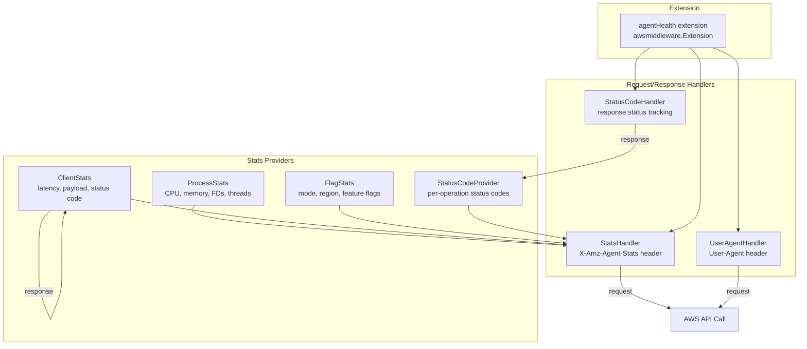

# Agent Self-Observability (Telemetry)

The CloudWatch Agent reports its own health and usage data to the CloudWatch backend via HTTP headers on every API call. This is controlled by the `usage_data` config option and the `CWAGENT_USAGE_DATA` environment variable.



## Agent Health Extension

The `agenthealth` extension (`extension/agenthealth/`) implements `awsmiddleware.Extension`, injecting request and response handlers into every AWS SDK call. It is registered per-signal (metrics, logs, traces) plus a `statuscode` variant:

```go
// translator/translate/otel/extension/agenthealth/translator.go
MetricsID    = component.NewIDWithName(agenthealth.TypeStr, "metrics")
LogsID       = component.NewIDWithName(agenthealth.TypeStr, "logs")
TracesID     = component.NewIDWithName(agenthealth.TypeStr, "traces")
StatusCodeID = component.NewIDWithName(agenthealth.TypeStr, "statuscode")
```

### Config

```go
// extension/agenthealth/config.go
type Config struct {
    IsUsageDataEnabled  bool                `mapstructure:"is_usage_data_enabled"`
    Stats               *agent.StatsConfig  `mapstructure:"stats,omitempty"`
    IsStatusCodeEnabled bool                `mapstructure:"is_status_code_enabled,omitempty"`
    UsageMetadata       []metadata.Metadata `mapstructure:"usage_metadata,omitempty"`
}
```

When `IsUsageDataEnabled` is false, only the User-Agent handler is registered (no stats).

### Handler Registration

`agentHealth.Handlers()` returns request and response handlers based on config:

| Handler | Type | Purpose |
|---|---|---|
| `userAgentHandler` | Request | Sets `User-Agent` header |
| `statsHandler` | Request | Sets `X-Amz-Agent-Stats` header |
| `clientStatsHandler` | Request + Response | Records latency, payload size, status code per request |
| `StatusCodeHandler` | Response | Tracks per-operation status code counts |

## Stats Collection

### Stats Struct

All stats are merged into a single `agent.Stats` struct and serialized as the `X-Amz-Agent-Stats` header value:

```go
// extension/agenthealth/handler/stats/agent/agent.go
type Stats struct {
    CPUPercent                *float64          `json:"cpu,omitempty"`
    MemoryBytes               *uint64           `json:"mem,omitempty"`
    FileDescriptorCount       *int32            `json:"fd,omitempty"`
    ThreadCount               *int32            `json:"th,omitempty"`
    LatencyMillis             *int64            `json:"lat,omitempty"`
    PayloadBytes              *int              `json:"load,omitempty"`
    StatusCode                *int              `json:"code,omitempty"`
    SharedConfigFallback      *int              `json:"scfb,omitempty"`
    ImdsFallbackSucceed       *int              `json:"ifs,omitempty"`
    AppSignals                *int              `json:"as,omitempty"`
    EnhancedContainerInsights *int              `json:"eci,omitempty"`
    RunningInContainer        *int              `json:"ric,omitempty"`
    RegionType                *string           `json:"rt,omitempty"`
    Mode                      *string           `json:"m,omitempty"`
    EntityRejected            *int              `json:"ent,omitempty"`
    StatusCodes               map[string][5]int `json:"codes,omitempty"`
}
```

Fields use pointer types — `nil` means "not reported". `Marshal()` strips the outer `{}` braces for the header value.

### Stats Providers

Each provider implements `StatsProvider` and is polled on every allowed API request:

| Provider | Package | Data | Refresh Interval |
|---|---|---|---|
| `processStats` | `handler/stats/provider/` | CPU%, RSS memory, FD count, thread count | 1 minute |
| `clientStatsHandler` | `handler/stats/client/` | Request latency, payload bytes, status code, entity rejection | Per-request |
| `flagStats` | `handler/stats/provider/` | IMDS fallback, shared config, app signals, container, mode, region | 5 minutes |
| `StatusCodeProvider` | `handler/stats/provider/` | Per-operation status code counts (200/400/408/413/429) | 5-minute rotation |

### Interval Stats

`intervalStats` wraps `sync.Once` to rate-limit `Stats()` calls. After one read, the next read is blocked for the configured interval. The underlying `atomic.Value` is updated by background goroutines.

### Process Stats

Collected via `gopsutil/v3/process` for the agent's own PID:
- CPU percentage (truncated to 1 decimal)
- RSS memory bytes
- Open file descriptor count
- Thread count

A background goroutine refreshes every minute.

### Client Stats

`clientStatsHandler` uses a TTL cache (10s, 1000 entries) to correlate requests with responses:
1. `HandleRequest` records start time and payload size, keyed by request ID
2. `HandleResponse` computes latency, records status code, checks for `rejectedEntityInfo` in response body
3. Stats are stored per-operation in a `sync.Map`

### Status Code Tracking

`StatusCodeProvider` tracks per-operation status code counts in 5-minute windows:
- Incoming status codes are enqueued via a buffered channel (capacity 1000)
- A background goroutine processes entries and rotates stats every 5 minutes
- Tracked codes: 200, 400, 408, 413, 429
- Operations use short names (e.g., `PutRetentionPolicy` → `prp`, `DescribeInstances` → `di`)

### Usage Flags

`FlagSet` is an immutable-once-set flag store. Once a flag is set, its value cannot change. Flags include:

| Flag | Key | Type |
|---|---|---|
| `FlagIMDSFallbackSuccess` | `imds_fallback_success` | bool |
| `FlagSharedConfigFallback` | `shared_config_fallback` | bool |
| `FlagAppSignal` | `application_signals` | bool |
| `FlagEnhancedContainerInsights` | `enhanced_container_insights` | bool |
| `FlagRunningInContainer` | `running_in_container` | bool |
| `FlagMode` | `mode` | string |
| `FlagRegionType` | `region_type` | string |

Flags trigger `OnChange` callbacks, which cause `flagStats` to recompute its cached stats.

### Operations Filter

Each agenthealth instance is configured with allowed operations. The stats handler only fires for matching API operations:
- Metrics: `PutMetricData`
- Logs: `PutLogEvents`
- Traces: `PutTraceSegments`
- StatusCode: `PutRetentionPolicy`, `DescribeInstances`, `DescribeTags`, `DescribeVolumes`, `CreateLogGroup`, `CreateLogStream`, `AssumeRole`, etc.

## User-Agent String

The `useragent` package (`handler/useragent/`) constructs a User-Agent header reporting the agent version, active components, and feature flags.

### Format

```
CWAgent/<version> (<go-version>; <os>; <arch>) ID/<uuid> inputs:(<list>) processors:(<list>) outputs:(<list>) feature:(<list>)
```

Example:
```
CWAgent/1.300001.0 (go1.25.7; linux; amd64) ID/abc-123 inputs:(cpu mem) processors:(ec2tagger) outputs:(cloudwatch) feature:(ipv6)
```

### Component Discovery

`SetComponents()` scans both the OTel and Telegraf configs to enumerate active components:
- Telegraf inputs/outputs from `telegraf.Config`
- OTel receivers (stripping `telegraf_` prefix), processors, exporters from pipeline config
- Special detection: JMX target systems, awsemf app signals/enhanced container insights, SELinux, ROSA
- `run_as_user` flag added when not running as root

### Usage Data Control

The `usage_data` JSON config option (under `agent` section) controls whether detailed component and stats information is sent:
- `true` (default): full User-Agent with components + stats headers
- `false`: only `CWAgent/<version> (<go-version>; <os>; <arch>)` in User-Agent, no stats headers

Can also be disabled via `CWAGENT_USAGE_DATA=FALSE` environment variable.

## Usage Metadata

The `metadata` package defines observability solution identifiers sent as feature flags:

| Metadata | Value |
|---|---|
| `obs_ec2_health` | EC2 health monitoring |
| `obs_jvm` | JVM monitoring |
| `obs_tomcat` | Tomcat monitoring |
| `obs_kafka_broker` | Kafka broker monitoring |
| `obs_kafka_consumer` | Kafka consumer monitoring |
| `obs_kafka_producer` | Kafka producer monitoring |
| `obs_nvidia_gpu` | NVIDIA GPU monitoring |

These are configured via the `usage_metadata` array in the agent JSON config and added as feature flags in the User-Agent header.

## Logging

### Logger Package

The `logger/` package provides a `zap.Logger` wrapped with a Telegraf-compatible encoder:
- Output format: `<level-letter>! <json-payload>` (e.g., `I! {"msg":"starting"}`)
- Level mapping: `D` (Debug), `I` (Info), `W` (Warn), `E` (Error), `F` (Fatal)
- Level is dynamically adjustable via `SetLevel()`
- Converts between Telegraf `wlog.Level` and `zap.AtomicLevel`

### Log Rotation

The start script (`cmd/start-amazon-cloudwatch-agent/`) configures lumberjack for log rotation when not running in a container:

```go
writer = &lumberjack.Logger{
    Filename:   paths.AgentLogFilePath,
    MaxSize:    100, // MB
    MaxBackups: 5,
    MaxAge:     7,   // days
    Compress:   true,
}
```

The main agent binary uses Telegraf's `logger.LogConfig` for rotation settings (configurable via TOML agent section: `logfile`, `logtarget`, `logfile_rotation_interval`, `logfile_rotation_max_size`, `logfile_rotation_max_archives`).

In containers, logs go to stdout (no file rotation).

## Profiler

The `profiler/` package provides a simple key-value stats accumulator for internal performance tracking:

```go
// profiler/profiler.go
profiler.Profiler.AddStats([]string{"subsystem", "metric"}, value)
profiler.Profiler.ReportAndClear() // logs all stats at Debug level, then resets
```

Stats are accumulated additively (same key values are summed). `ReportAndClear()` logs all stats and resets the map. Protected by a `sync.Mutex`.

## Related Docs

- [Configuration](configuration.md) — `usage_data` config option
- [Plugins & Pipeline](plugins-pipeline.md) — extension lifecycle
- [Error Handling](error-handling.md) — retry patterns that generate stats
- [Concurrency](concurrency.md) — goroutine patterns in stats providers
