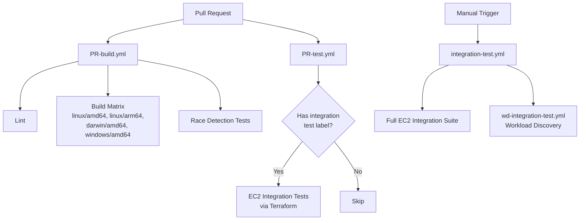
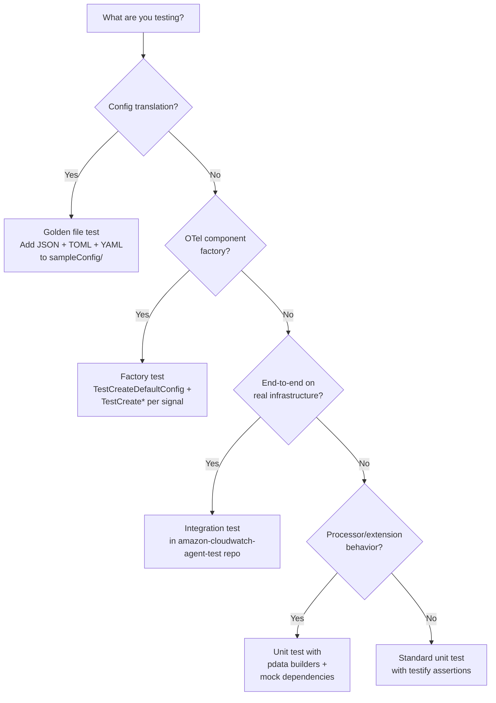

# Testing

This document covers the testing infrastructure, patterns, and conventions used in the CloudWatch Agent codebase.

## Test Commands

| Command | Description |
|---|---|
| `make test` | `CGO_ENABLED=0 go test -timeout 15m -coverprofile coverage.txt -failfast ./...` |
| `make test-data-race` | `CGO_ENABLED=1 go test -timeout 15m -race -parallel 4` (excludes known racy packages) |

Coverage output goes to `coverage.txt` (gitignored).

## Test Patterns

### OTel Component Factory Tests

Every OTel component (processor, extension, receiver, exporter) has a `factory_test.go` with two standard tests:

1. `TestCreateDefaultConfig` — verifies the factory produces a valid config struct
2. `TestCreateProcessor` / `TestCreate` / `TestCreateMetricsReceiver` — verifies the factory creates a component instance

Processor factory test (from `plugins/processors/gpuattributes/factory_test.go`):

```go
func TestCreateDefaultConfig(t *testing.T) {
    factory := NewFactory()
    require.NotNil(t, factory)
    cfg := factory.CreateDefaultConfig()
    assert.NotNil(t, cfg, "failed to create default config")
    assert.NoError(t, componenttest.CheckConfigStruct(cfg))
}

func TestCreateProcessor(t *testing.T) {
    factory := NewFactory()
    cfg := factory.CreateDefaultConfig()
    setting := processortest.NewNopSettings(component.MustNewType("gpuattributes"))

    tProcessor, err := factory.CreateTraces(context.Background(), setting, cfg, consumertest.NewNop())
    assert.Equal(t, err, pipeline.ErrSignalNotSupported)
    assert.Nil(t, tProcessor)

    mProcessor, err := factory.CreateMetrics(context.Background(), setting, cfg, consumertest.NewNop())
    assert.NoError(t, err)
    assert.NotNil(t, mProcessor)

    lProcessor, err := factory.CreateLogs(context.Background(), setting, cfg, consumertest.NewNop())
    assert.Equal(t, err, pipeline.ErrSignalNotSupported)
    assert.Nil(t, lProcessor)
}
```

Extension factory test (from `extension/agenthealth/factory_test.go`):

```go
func TestCreateDefaultConfig(t *testing.T) {
    cfg := NewFactory().CreateDefaultConfig()
    assert.Equal(t, &Config{IsUsageDataEnabled: true, Stats: nil}, cfg)
    assert.NoError(t, componenttest.CheckConfigStruct(cfg))
}

func TestCreate(t *testing.T) {
    cfg := &Config{}
    got, err := NewFactory().Create(context.Background(), extensiontest.NewNopSettings(TypeStr), cfg)
    assert.NoError(t, err)
    assert.NotNil(t, got)
}
```

Key OTel test helpers:
- `componenttest.CheckConfigStruct(cfg)` — validates config struct tags
- `processortest.NewNopSettings(type)` — creates no-op processor settings
- `extensiontest.NewNopSettings(type)` — creates no-op extension settings
- `receivertest.NewNopSettings(type)` — creates no-op receiver settings
- `consumertest.NewNop()` — creates a no-op consumer for pipeline wiring

### Golden File Tests

The config translation system uses golden file testing in `translator/tocwconfig/sampleConfig/`. Each test case has a triplet of files:

```
sampleConfig/
├── basic_config_linux.json    # Input: user JSON config
├── basic_config_linux.conf    # Expected: legacy TOML output
└── basic_config_linux.yaml    # Expected: OTel YAML output
```

There are ~76 JSON inputs, ~80 TOML golden files, and ~85 YAML golden files.

The `checkTranslation` helper in `translator/tocwconfig/tocwconfig_test.go` drives the pattern:

```go
func checkTranslation(t *testing.T, fileName string, targetPlatform string,
    expectedEnvVars map[string]string, appendString string,
    tokenReplacements ...map[string]string) {
    jsonFilePath := fmt.Sprintf("./sampleConfig/%v.json", fileName)
    tomlFilePath := fmt.Sprintf("./sampleConfig/%v%v.conf", fileName, appendString)
    yamlFilePath := fmt.Sprintf("./sampleConfig/%v%v.yaml", fileName, appendString)
    checkTranslationForPaths(t, jsonFilePath, tomlFilePath, yamlFilePath, targetPlatform, tokenReplacements...)
    if expectedEnvVars != nil {
        content, err := os.ReadFile(jsonFilePath)
        require.NoError(t, err)
        checkIfEnvTranslateSucceed(t, string(content), targetPlatform, expectedEnvVars)
    }
}
```

Each test function sets up context (mode, platform, env vars), then calls `checkTranslation`:

```go
func TestBaseContainerInsightsConfig(t *testing.T) {
    resetContext(t)
    context.CurrentContext().SetRunInContainer(true)
    context.CurrentContext().SetMode(config.ModeEC2)
    t.Setenv(config.HOST_NAME, "host_name_from_env")
    t.Setenv(config.HOST_IP, "127.0.0.1")
    checkTranslation(t, "base_container_insights_config", "linux", nil, "")
}
```

The `resetContext` helper resets the translation context singleton between tests, clearing IMDS retries, region detection, credentials path, and OTLP config cache.

Golden file naming conventions:
- Platform suffix: `_linux`, `_windows`, `_darwin`
- Append string for variants (e.g., `_with_credentials`)
- Token replacement for dynamic values (Prometheus config paths, ECS SD file names)

### Mock Patterns

The codebase uses two mocking approaches:

1. `testify/mock` — for interface-based mocks with call expectations:

```go
type mockServiceProvider struct {
    mock.Mock
}

func (s *mockServiceProvider) addEntryForLogGroup(logGroupName LogGroupName, serviceAttr ServiceAttribute) {
    s.Called(logGroupName, serviceAttr)
}
```

2. Manual mocks with controllable behavior (from `plugins/processors/ec2tagger/ec2tagger_test.go`):

```go
type mockEC2Client struct {
    ec2iface.EC2API
    tagsCallCount    int
    tagsFailLimit    int
    tagsPartialLimit int
}

func (m *mockEC2Client) DescribeTags(*ec2.DescribeTagsInput) (*ec2.DescribeTagsOutput, error) {
    m.tagsCallCount++
    if m.tagsCallCount <= m.tagsFailLimit {
        return nil, errors.New("...")
    }
    // return partial or full tags based on count
}
```

### OTel Translation Tests

Tests for OTel component translators in `translator/translate/otel/` use `confmap.Conf` as input and verify the produced `component.Config`:

```go
func TestTranslator(t *testing.T) {
    testCases := map[string]struct {
        input   map[string]interface{}
        want    *want
        wantErr error
    }{
        "WithMetricsSection": {
            input: map[string]interface{}{
                "metrics": map[string]interface{}{},
            },
            want: &want{
                pipelineID: "metrics/host",
                receivers:  []string{"nop", "other"},
                processors: []string{"awsentity/resource"},
                exporters:  []string{"awscloudwatch"},
            },
        },
    }
    // ...
}
```

## Test Helper Packages

| Package | Purpose |
|---|---|
| `tool/testutil` | `LogSink` (thread-safe `telegraf.Logger` capturing log lines), `NopLogger`, `SetUpTestInputStream` (stdin mock for wizard tests) |
| `internal/detector/detectortest` | `MockProcess`, `MockProcessDetector`, `MockDeviceDetector`, `MockExtractor`, `MockProcessFilter`, `MockNameFilter` — all implement detector interfaces via `testify/mock`. Also `CmdlineArgsFromFile` for loading test cmdline data. |
| `internal/state/statetest` | `FileRangeManagerSink` — wraps a `FileRangeManager` and captures all `Enqueue` calls in a sink for assertion |

## Test Data Directories

Many packages use `testdata/` directories for fixture files:

- `receiver/adapter/testdata/` — Telegraf plugin TOML configs (e.g., `cpu_plugin.toml`)
- `plugins/outputs/cloudwatch/testdata/` — CloudWatch API response fixtures
- `plugins/processors/awsapplicationsignals/testdata/` — Application Signals test data
- `plugins/inputs/nvidia_smi/testdata/` — nvidia-smi XML output samples
- `internal/detector/java/testdata/`, `tomcat/testdata/`, `kafkabroker/testdata/` — Process cmdline and file fixtures for workload detection
- `internal/tls/testdata/` — TLS certificate files for cert watcher tests
- `cfg/aws/testdata/` — AWS credential config test files
- `cmd/xray-migration/testdata/` — X-Ray daemon config migration fixtures
- `translator/tocwconfig/sampleConfig/` — Golden file triplets (JSON/TOML/YAML)

## Race Detector Testing

`make test-data-race` runs with `-race` but excludes packages with known data races:

| Package | Known Issue |
|---|---|
| `extension/entitystore` | Concurrent entity metadata access |
| `extension/server` | HTTP handler state |
| `internal/publisher` | Non-blocking FIFO queue |
| `internal/retryer` | Retry state |
| `internal/tls` | Certificate watcher |
| `plugins/inputs/logfile` | Tailer goroutines |
| `plugins/inputs/logfile/tail` | File tail state |
| `plugins/outputs/cloudwatch` | Metric aggregation |
| `plugins/processors/ec2tagger` | Tag refresh goroutine |

These are excluded via a grep pattern: `go list ./... | grep -v -E '<pattern>'`.

## CI Test Workflows



- `PR-build.yml` — Runs on every PR: lint, build matrix (4 OS/arch combos), race detection tests
- `PR-test.yml` — Label-gated: runs EC2 integration tests only when a specific label is applied
- `integration-test.yml` — Manual trigger with build artifact ID: full integration suite across OS variants using Terraform-provisioned EC2 instances
- `wd-integration-test.yml` — Workload discovery integration tests
- Integration tests live in a separate repo: `aws/amazon-cloudwatch-agent-test`

## Decision Tree: Test Type Selection



| Scenario | Test Type | Location |
|---|---|---|
| New config field translation | Golden file | `translator/tocwconfig/sampleConfig/` |
| New OTel component | Factory test | `<component>/factory_test.go` |
| OTel translator rule | Translator unit test | `translator/translate/otel/<type>/<name>/*_test.go` |
| Processor data transformation | Unit test with pdata | `<processor>/*_test.go` |
| AWS API interaction | Unit test with mock client | `<package>/*_test.go` |
| Agent on real EC2 | Integration test | `amazon-cloudwatch-agent-test` repo |
| Workload detection logic | Unit test with mock process | `internal/detector/<type>/*_test.go` |

## Related Docs

- [Build and Tooling](build-and-tooling.md) — Make targets, CI workflows
- [Plugins and Pipeline](plugins-pipeline.md) — OTel component factory pattern
- [Config Translation](config-translation.md) — Translation engine and golden file details
- [Concurrency](concurrency.md) — Data race packages and mitigation
